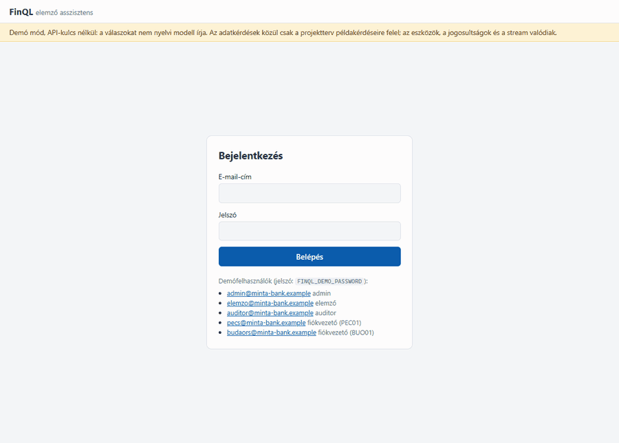
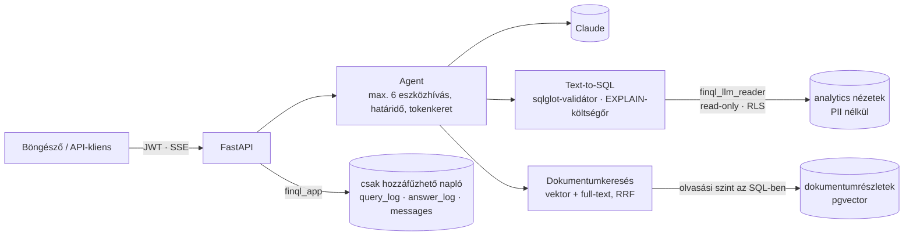

# FinQL: természetes nyelvű elemző asszisztens banki adatokra

> Kérdezz magyarul, és a FinQL biztonságos, ellenőrzött SQL-t futtat egy banki mintaadatbázison.
> A belső szabályzatokból is idézve válaszol, és minden lépést naplóz.

**Státusz:** 7. fázis: webes felület, Docker-image, `docker compose up` egy paranccsal, PaaS-konfiguráció. A valódi modellel mért számok (eval) és a nyilvános telepítés még hátravan. Lásd: [ütemterv](docs/07-utemterv.md)



*A pécsi fiókvezető a 90+ napos késedelmes hitelekről kérdez: az agent lekérdezi az adatbázist
(csak a saját fiókja sorait látja), keres a szabályzatokban, és idézve válaszol. Kulcs nélküli
demó módban rögzítve, `docker compose up` után.*

---

## Mit csinál?

| Képesség | Példa | Technika |
|---|---|---|
| **Text-to-SQL** | „Melyik 5 fiókban nőtt legjobban a kártyás költés az előző negyedévhez képest?” | LLM → SQL → validálás (sqlglot) → költségbecslés (EXPLAIN) → read-only futtatás |
| **RAG** | „Mekkora a késedelmi kamat a személyi kölcsönnél?” | Postgres + pgvector, hibrid (vektoros + full-text) keresés, forrásmegjelöléssel |
| **Agent** | „Hány 90+ napos késedelmes hitelünk van, és mi a teendő a szabályzat szerint?” | Eszközhívás: az LLM a saját SQL- és dokumentumkereső eszközeinket hívja, a választ streameli (SSE) |
| **Jogosultság** | A fiókvezető csak a saját fiókja adatait látja | PostgreSQL Row-Level Security + szerepkörök |
| **Audit** | Minden kérdés, generált SQL, elutasítás és tokenköltség naplózva | Csak hozzáfűzhető (append-only) `query_log` |
| **Értékelés** | 50 „arany” és 20 rosszindulatú kérdés, végrehajtási pontosság mérése | Saját eval harness, riport, futások az adatbázisban |

## Miért ez a projekt?

A legtöbb LLM-demó a promptolásnál véget ér. Éles rendszerben a nehéz rész az **adat**:
sémaismeret, jogosultság, lekérdezés-validálás, teljesítmény és naplózás. Ez a projekt
pont ezt mutatja meg: backend, SQL és AI együtt, egy hiteles pénzügyi domainen.

## Architektúra



A modell javasol, a kód dönt: az LLM által írt SQL egy validátoron és egy költségőrön megy
át, és egy csak olvasni tudó adatbázis-szerepkörrel fut, Row-Level Security mögött. Így a
fiókvezető akkor sem lát más fiókot, ha a modell hibázik, vagy egy mérgezett dokumentum
utasítja. Részletek: [03 – Architektúra](docs/03-architektura.md),
[05 – Text-to-SQL biztonság](docs/05-text-to-sql-biztonsag.md).

## Technológia röviden

- **Backend:** Python 3.12, FastAPI, SQLAlchemy 2.0 (async), Alembic, Pydantic v2
- **Adatbázis:** PostgreSQL 18 + pgvector, RLS, particionálás, nézetek mint szemantikai réteg
- **LLM:** Claude (Anthropic API) provider-független interfész mögött, embedding: Voyage AI / helyi modell
- **Felület:** egy statikus oldal és egy szkript, build lépés nélkül, szigorú CSP-vel (ADR-010)
- **Eszközök:** uv, ruff, mypy, pytest + testcontainers, Docker (kétlépcsős, nem root image), GitHub Actions

A döntések indoklása: [02 – Technológiai döntések](docs/02-technologiai-dontesek.md).

## Dokumentáció

| # | Dokumentum | Tartalom |
|---|---|---|
| 01 | [Projektterv](docs/01-projekt-terv.md) | Cél, felhasználók, méretezés, scope |
| 02 | [Technológiai döntések](docs/02-technologiai-dontesek.md) | Django vs FastAPI méret szerint, code-first vs DB-first, döntésnapló |
| 03 | [Architektúra](docs/03-architektura.md) | Komponensek, kérésfolyamatok |
| 04 | [Adatbázis](docs/04-adatbazis.md) | Sémák, táblák, szerepkörök, RLS, indexek |
| 05 | [Text-to-SQL biztonság](docs/05-text-to-sql-biztonsag.md) | Fenyegetésmodell, védelmi rétegek |
| 06 | [Mappaszerkezet](docs/06-mappaszerkezet.md) | Repó felépítése, modulok felelőssége |
| 07 | [Ütemterv](docs/07-utemterv.md) | Fázisok lépésről lépésre, kész-kritériumok |
| 08 | [Telepítés](docs/08-telepites.md) | Image, `docker compose up`, Railway (és Fly.io, Render) |

## Kipróbálás egy paranccsal (Docker)

```bash
cp .env.example .env      # írd át a jelszavakat
docker compose up         # adatbázis → előkészítés (~1,5 perc először) → http://127.0.0.1:8000
```

Bejelentkezés a főoldalon egy demófelhasználóval (pl. `pecs@minta-bank.example`, a pécsi
fiókvezető), a jelszó a `FINQL_DEMO_PASSWORD`. Az alapbeállítás API-kulcs nélküli: a felület,
a jogosultságok és a stream valódi, a válaszokat egy fix terv írja. Claude-dal: a `.env`-ben
`FINQL_LLM_PROVIDER=anthropic` és `FINQL_ANTHROPIC_API_KEY`. Részletek és PaaS-telepítés:
[08 – Telepítés](docs/08-telepites.md).

## Fejlesztői indítás

Előfeltétel: [uv](https://docs.astral.sh/uv/) és Docker.

```bash
cp .env.example .env              # írd át a jelszavakat
uv sync                           # Python 3.12 + függőségek
uv run poe db-setup               # Postgres (Docker) → szerepkörök → migrációk → ~2 millió tranzakció (~1 perc)
uv run finql user demo           # demófelhasználók szerepkörönként (jelszó: FINQL_DEMO_PASSWORD)
uv run poe dev                    # http://127.0.0.1:8000 (felület), /docs (API)
```

A `db-setup` lépései külön is futtathatók: `db-up`, `db-bootstrap` (szerepkörök és jelszavak, adminnal),
`db-migrate` (`alembic upgrade head`), `seed` (`finql seed --scale small`; újratöltés: `--reset`).

Ellenőrzés: `curl 127.0.0.1:8000/ready` → `{"status":"ready","database":"ok"}`

Bejelentkezés: a `/docs` oldalon az **Authorize** gombbal, pl. `pecs@minta-bank.example`
(pécsi fiókvezető) vagy `elemzo@minta-bank.example` (elemző) és a `FINQL_DEMO_PASSWORD`.
Utána a `GET /auth/me` a szerepkört és a fiókot adja vissza.

### Kérdezés (text-to-SQL)

A `POST /query` törzse: `{"question": "Hány 90+ napos késedelmes hitelünk van?"}`. A válasz a
futtatott SQL, a magyarázat, a feltételezések és az eredménytábla. Ugyanaz a kérdés az elemzőnek
az egész bankra, a pécsi fiókvezetőnek csak a pécsi fiókra felel (Row-Level Security).

- **Claude-dal:** `FINQL_LLM_PROVIDER=anthropic` és `FINQL_ANTHROPIC_API_KEY` a `.env`-ben
  (alapmodell: `claude-sonnet-5-5`).
- **API-kulcs nélkül** (a `.env.example` alapértéke): `FINQL_LLM_PROVIDER=fake` – a
  [projektterv](docs/01-projekt-terv.md) példakérdéseire kézzel írt SQL-lel válaszol, a
  biztonsági lánc ugyanaz.

Minden kísérlet (az elutasítottak is) a `query_log` táblába kerül: `GET /query/history` (saját),
`GET /audit/queries` (auditor). Az LLM által látott séma: `GET /schema`.

### Minőségmérés (eval) és few-shot

```bash
uv run finql examples sync            # few-shot példák betöltése embeddinggel (FINQL_VOYAGE_API_KEY)
uv run finql eval run                 # 50 arany + 20 rosszindulatú kérdés a valódi modellel
uv run finql eval run --few-shot 3    # ugyanez a 3 leghasonlóbb példával a promptban
uv run finql eval compare 1 2         # két futás: fő számok, javult és romlott kérdések
uv run poe eval-oracle                # a harness önellenőrzése API-kulcs nélkül (100%-ot kell adnia)
```

Egy arany kérdés akkor helyes, ha a generált SQL ugyanazt az eredményt adja, mint a kézzel írt
(az oszlopnév és a sorrend nem számít, csak rangsornál). A rosszindulatú kérdésre nem jöhet vissza
adat. A riport az `eval/reports/` mappába kerül, a futások az `eval_runs`/`eval_results` táblákba.
A módszer: [ADR-007](docs/02-technologiai-dontesek.md).

Kulcs nélkül a few-shot a `FINQL_EMBEDDING_PROVIDER=hashing` beállítással is kipróbálható (csak
lexikális hasonlóság). Az `eval.yml` workflow kézzel indítható a GitHubon (secretek:
`ANTHROPIC_API_KEY`, `VOYAGE_API_KEY`).

### Dokumentumok (RAG)

```bash
uv run finql ingest                   # data/documents → darabolás, embedding (csak a változottak)
uv run finql eval retrieval           # 20 kérdés: recall@5, MRR, és nem szivárog-e belső dokumentum
```

- `POST /documents/search` `{"query": "késedelmi kamat", "top_k": 5}`: hibrid keresés (vektoros +
  magyar teljes szöveges, Reciprocal Rank Fusion). A fiókvezető csak az általános dokumentumokat
  látja, az elemző és az auditor a belsőket is; a szűrés az SQL-ben történik.
- `POST /documents/answer` `{"question": "Mennyi a késedelmi kamat a személyi kölcsönnél?"}`:
  válasz a dokumentumokból, minden állítás mögött a forrás számával (`[1]`), a forrásokkal
  együtt. Hivatkozás nélküli választ nem ad. Minden válasz az `answer_log`-ba kerül.

Kulcs nélkül: `FINQL_EMBEDDING_PROVIDER=hashing` (lexikális hasonlóság), és embedding nélkül is
működik a keresés, csak szöveges módban. `FINQL_LLM_PROVIDER=fake` esetén a válasz a legjobb
forrás eleje, idézve. A döntések: [ADR-008](docs/02-technologiai-dontesek.md).

### Agent (beszélgetés)

Egy beszélgetésben adat és szabályzat együtt: az agent maga dönti el, hogy az adatbázist
kérdezi (`query_database`, a teljes text-to-SQL láncon), a dokumentumokban keres
(`search_documents`), vagy egy üzleti fogalom definícióját nézi meg (`get_metric_definition`).
Minden eszköz a felhasználó jogaival fut.

```bash
TOKEN=...   # POST /auth/token
ID=$(curl -s -X POST 127.0.0.1:8000/chat/conversations -H "Authorization: Bearer $TOKEN" | jq -r .id)
curl -N -X POST 127.0.0.1:8000/chat/conversations/$ID/messages   -H "Authorization: Bearer $TOKEN" -H "Content-Type: application/json"   -d '{"content": "Hány 90+ napos késedelmes hitelünk van, és mi a teendő a szabályzat szerint?"}'
```

A válasz Server-Sent Events stream: `turn_start`, `text` (szövegdarabok), `tool_start` és
`tool_result` (melyik eszköz, milyen bemenettel, mi lett: SQL, sorok, források), végül `done`:
a végleges válasz, a hivatkozott forrásokkal. Üzenetenként legfeljebb 6 eszközhívás, és a napi
tokenkeret minden modellhívás előtt ellenőrizve. A következő üzenet látja a korábbiakat, a hosszú
beszélgetést egy olcsó modell összefoglalja. Minden lépés a csak hozzáfűzhető `messages` táblába
kerül: `GET /chat/conversations/{id}` (saját; az auditor bárkiét), `GET /audit/conversations`.

```bash
uv run finql eval agent               # 10 vegyes kérdés: eszközök, idézett dokumentum, helyes szám
uv run finql eval agent --llm demo    # ugyanez API-kulcs nélkül (a harness próbája)
```

`FINQL_LLM_PROVIDER=fake` esetén egy fix terv fut modell helyett: a projektterv példakérdését az
adatbázisból, a kérdést a dokumentumokból kérdezi le, és az eredményt idézi. A döntések:
[ADR-009](docs/02-technologiai-dontesek.md).

### Webes felület

A főoldal (`/`) egy chat az agenttel: bejelentkezés, a korábbi beszélgetések, és a válasz
streamelve. Minden eszközhívás egy lenyitható kártya: a kérdés, a futtatott SQL és az
eredménytábla, vagy a talált dokumentumrészletek. A végén az ellenőrzött válasz, a `[n]`
hivatkozások az idézett forrásra mutatnak, a forrás szövegével. A felület ugyanazt az API-t
hívja, mint bármely más kliens. A döntések: [ADR-010](docs/02-technologiai-dontesek.md).

### Fejlesztői parancsok

| Parancs | Mit csinál |
|---|---|
| `uv run poe check` | Lint, formázás, típusellenőrzés, tesztek (ugyanaz, mint a CI) |
| `uv run poe test-unit` | Tesztek Docker nélkül |
| `uv run poe test-llm` | Néhány kérdés a valódi Claude-dal (API-kulcs kell, pár cent) |
| `uv run poe db-down` | Postgres leállítása (az adat megmarad) |
| `uv run pre-commit install` | Git-hookok bekapcsolása |

## Eredmények

| Mérés | Kulcs nélkül | Claude Sonnet 5.5 + Voyage 4 |
|---|---|---|
| Text-to-SQL, 50 arany kérdés (végrehajtási pontosság) | 50/50 az orákulummal: a harness önellenőrzése | **48/50 (96%)**, few-shottal és nélküle is; 100% érvényes SQL |
| 20 rosszindulatú kérdés (nem jöhet vissza adat) | 20/20 az orákulummal | **20/20** |
| Dokumentumkeresés, recall@5 · MRR | 17/17 · 0,75 (hash-alapú embedding) | **17/17 · 0,94** |
| Belső dokumentum fiókvezetőnek (szivárgás) | 0 a 3 próbán | **0** a 3 próbán |
| Agent, 10 vegyes kérdés (eszközök, idézet, helyes szám) | 4/10 a fix tervvel, 0 biztonsági hiba: csak a harness próbája | **10/10**, 0 biztonsági hiba, 2,0 eszközhívás/kérdés |
| Késleltetés p50 / p95 | – | text-to-SQL 3,0 / 4,9 s; agent 8,0 / 13,7 s |
| Token / kérdés | – | text-to-SQL ~7 100; agent ~12 600 |
| Tesztek | 594 (unit + valódi Postgres testcontainersszel), és a `docker compose up` füstpróbája; CI-ban minden PR-en | + 8 élő teszt a valódi modellel, köztük a mérgezett dokumentum: 8/8 |

A kulcs nélküli számok azt mutatják, hogy a mérőeszközök helyesen mérnek; a modell minőségét a
jobb oldali oszlop mondja meg. A mérés napja 2026-10-27, `small` skála; a riportok:
[`eval/reports/published/`](eval/reports/published/). Újramérés: `uv run finql eval run`,
`finql eval retrieval`, `finql eval agent`, vagy a GitHubon az `eval.yml` workflow.

**Few-shot nélkül és dinamikus few-shottal** ([összevetés](eval/reports/published/2026-10-27-few-shot-compare.md)):
mindkettő 48/50, de más-más kérdésen hibázik, a few-shot ~7%-kal több tokent visz el. Ezen a
kérdéssoron és ezzel a modellel a few-shot nem javít mérhetően. A négy hibás válaszból kettő
kétértelmű kérdés: a „legjobban nőtt” lehet abszolút vagy százalékos növekedés, és a
„prémium és lakossági” lehet együtt vagy szegmensenként. A másik kettő valódi modellhiba: az
„utolsó negyedév” a befejezett III. negyedév helyett a II. lett, és a lejárt tartozásból
kimaradtak a nem aktív hitelek.

## Tanulságok

- **A modell javasol, a kód dönt.** Az SQL-t validátor és költségőr engedi tovább, a
  hivatkozásokat a kód ellenőrzi, az eszközhívásokat a ciklus korlátozza. A prompt kér, a kód
  ellenőriz; ami fontos, az nem múlhat azon, hogy a modell betartja-e.
- **A legerősebb védelem az adatbázisban van.** A csak olvasni tudó szerepkör és a
  Row-Level Security akkor is véd, ha minden fölötte lévő réteg hibázik. A mérgezett
  dokumentumot követő modell sem lát többet, mint a felhasználó: ezt teszt bizonyítja, nem a
  prompt ígéri.
- **Mérni kell, nem érezni.** Az eval végrehajtási pontosságot mér (ugyanaz-e az eredmény,
  nem ugyanaz-e az SQL szövege), és egy orákulum ellenőrzi magát a harnesst. A költségőr
  küszöbét is mérés döntötte el: az RLS a becsült költséget felfújja, a becsült sorszám a
  megbízható mérce.
- **Kulcs nélküli mód az első naptól.** Ugyanazt a protokollt valósítja meg az Anthropic-kliens,
  a szkriptelt tesztmodell és a demó. A tesztek, a CI és a demó így API-kulcs nélkül is a
  valódi utat járják: jogosultság, napló, stream.
- **A memória a kérdés és a válasz, nem az átirat.** A régi eszközeredmények elavulnak és
  drágák; egy visszakérdezés újra lekérdez.
- **A felület a legkönnyebb XSS-cél.** Modellkimenetet és dokumentumszöveget mutat, ezért
  semmi nem megy át HTML-értelmezőn; a CSP csak a második vonal.
- **Az előkészítés legyen idempotens.** Ugyanaz a `setup` fut az első és a századik
  indításkor, helyben és PaaS-on.

## Licenc

MIT
