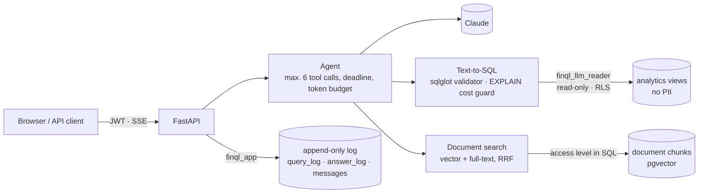

# FinQL: a natural-language analytics assistant for banking data

**English** · [Magyar](README.hu.md)

> Ask in Hungarian, and FinQL runs safe, validated SQL on a sample bank database.
> It also answers with citations from internal policies, and logs every step.

**Status:** done. Phases 0–8, with results measured on the real model; from phase 8 (advanced): the hash-chained log, the MCP server and OpenTelemetry tracing. The only open item is the public deployment (needs a Railway account). See the [roadmap](docs/07-utemterv.md)


*The Pécs branch manager asks about loans 90+ days past due: the agent queries the database
(it sees only that branch's rows), searches the policies, and answers with citations. Recorded
in keyless demo mode, after `docker compose up`.*

---

## What does it do?

| Capability | Example | Technique |
|---|---|---|
| **Text-to-SQL** | „Melyik 5 fiókban nőtt legjobban a kártyás költés az előző negyedévhez képest?” ("Which 5 branches had the largest growth in card spending compared to the previous quarter?") | LLM → SQL → validation (sqlglot) → cost estimate (EXPLAIN) → read-only execution |
| **RAG** | „Mekkora a késedelmi kamat a személyi kölcsönnél?” ("What is the late-payment interest on personal loans?") | Postgres + pgvector, hybrid (vector + full-text) search, with source citations |
| **Agent** | „Hány 90+ napos késedelmes hitelünk van, és mi a teendő a szabályzat szerint?” ("How many loans are 90+ days past due, and what does the policy say to do?") | Tool calling: the LLM calls our own SQL and document search tools and streams the answer (SSE) |
| **Permissions** | A branch manager sees only their own branch's data | PostgreSQL Row-Level Security + roles |
| **Audit** | Every question, generated SQL, rejection and token cost is logged | Append-only, hash-chained `query_log` |
| **MCP** | FinQL's tools from Claude Desktop or Claude Code | MCP server over stdio, with the same tools and permissions as the agent |
| **Evaluation** | 50 "golden" and 20 malicious questions, measuring execution accuracy | Custom eval harness, report, runs stored in the database |

## Why this project?

Most LLM demos stop at prompting. In a production system the hard part is the **data**:
schema knowledge, permissions, query validation, performance and logging. This project
shows exactly that: backend, SQL and AI together, in a realistic financial domain.

## Architecture



The model proposes, the code decides: SQL written by the LLM passes through a validator and a
cost guard, and runs under a read-only database role, behind Row-Level Security. So a branch
manager cannot see another branch, even if the model makes a mistake or a poisoned document
instructs it to. Details: [03 – Architecture](docs/03-architektura.md),
[05 – Text-to-SQL security](docs/05-text-to-sql-biztonsag.md).

## Tech stack

- **Backend:** Python 3.12, FastAPI, SQLAlchemy 2.0 (async), Alembic, Pydantic v2
- **Database:** PostgreSQL 18 + pgvector, RLS, partitioning, views as a semantic layer
- **LLM:** Claude (Anthropic API) behind a provider-independent interface; embeddings: Voyage AI / local model
- **UI:** one static page and one script, no build step, strict CSP (ADR-010)
- **Tooling:** uv, ruff, mypy, pytest + testcontainers, Docker (multi-stage, non-root image), GitHub Actions

Rationale for the decisions: [02 – Technology decisions](docs/02-technologiai-dontesek.md).

## Documentation

The design documents are in Hungarian.

| # | Document | Contents |
|---|---|---|
| 01 | [Project plan](docs/01-projekt-terv.md) | Goal, users, sizing, scope |
| 02 | [Technology decisions](docs/02-technologiai-dontesek.md) | Django vs FastAPI by project size, code-first vs DB-first, decision log |
| 03 | [Architecture](docs/03-architektura.md) | Components, request flows |
| 04 | [Database](docs/04-adatbazis.md) | Schemas, tables, roles, RLS, indexes |
| 05 | [Text-to-SQL security](docs/05-text-to-sql-biztonsag.md) | Threat model, layers of defense |
| 06 | [Folder structure](docs/06-mappaszerkezet.md) | Repo layout, module responsibilities |
| 07 | [Roadmap](docs/07-utemterv.md) | Phases step by step, definitions of done |
| 08 | [Deployment](docs/08-telepites.md) | Image, `docker compose up`, Railway (and Fly.io, Render) |

## Try it with one command (Docker)

```bash
cp .env.example .env      # change the passwords
docker compose up         # database → setup (~1.5 min the first time) → http://127.0.0.1:8000
```

Log in on the home page with a demo user (e.g. `pecs@minta-bank.example`, the Pécs branch
manager); the password is `FINQL_DEMO_PASSWORD`. The default setup needs no API key: the UI,
the permissions and the stream are real, and the answers come from a fixed plan. To use Claude,
set `FINQL_LLM_PROVIDER=anthropic` and `FINQL_ANTHROPIC_API_KEY` in `.env`. Details and PaaS
deployment: [08 – Deployment](docs/08-telepites.md).

## Manual demo scenarios

Step-by-step scenarios for each demo user (what to open, what to click, the expected result):
[English](manual-demo/angol/README.md) · [Magyar](manual-demo/magyar/README.md). The deployed
demo links the Hungarian ones from its login page.

## Development setup

Prerequisites: [uv](https://docs.astral.sh/uv/) and Docker.

```bash
cp .env.example .env              # change the passwords
uv sync                           # Python 3.12 + dependencies
uv run poe db-setup               # Postgres (Docker) → roles → migrations → ~2 million transactions (~1 min)
uv run finql user demo           # demo users, one per role (password: FINQL_DEMO_PASSWORD)
uv run poe dev                    # http://127.0.0.1:8000 (UI), /docs (API)
```

The `db-setup` steps can also be run separately: `db-up`, `db-bootstrap` (roles and passwords, as admin),
`db-migrate` (`alembic upgrade head`), `seed` (`finql seed --scale small`; to reload: `--reset`).

Check: `curl 127.0.0.1:8000/ready` → `{"status":"ready","database":"ok"}`

Login: on the `/docs` page with the **Authorize** button, e.g. `pecs@minta-bank.example`
(Pécs branch manager) or `elemzo@minta-bank.example` (analyst) and the `FINQL_DEMO_PASSWORD`.
After that, `GET /auth/me` returns the role and the branch.

### Asking questions (text-to-SQL)

The body of `POST /query`: `{"question": "Hány 90+ napos késedelmes hitelünk van?"}` ("How many
loans are 90+ days past due?"). The response contains the executed SQL, the explanation, the
assumptions and the result table. The same question returns figures for the whole bank to the
analyst, and only for the Pécs branch to the Pécs branch manager (Row-Level Security).

- **With Claude:** `FINQL_LLM_PROVIDER=anthropic` and `FINQL_ANTHROPIC_API_KEY` in `.env`
  (default model: `claude-sonnet-5-5`).
- **Without an API key** (the `.env.example` default): `FINQL_LLM_PROVIDER=fake`. It answers the
  example questions from the [project plan](docs/01-projekt-terv.md) with hand-written SQL; the
  security chain is the same.

Every attempt (rejected ones included) goes into the `query_log` table: `GET /query/history` (own),
`GET /audit/queries` (auditor). The schema the LLM sees: `GET /schema`.

The logs (`query_log`, `answer_log`) form a hash chain built by the database: a row that was later
modified, deleted or inserted can be detected, even if someone with higher privileges tampered with it.
To verify: `GET /audit/chain` (auditor) or `uv run finql audit verify --anchor horgony.json`;
the anchor file keeps the head of the chain outside the database, so even a full rewrite is detected
([05 – Security](docs/05-text-to-sql-biztonsag.md), ADR-012).

### Quality measurement (eval) and few-shot

```bash
uv run finql examples sync            # load few-shot examples with embeddings (FINQL_VOYAGE_API_KEY)
uv run finql eval run                 # 50 golden + 20 malicious questions with the real model
uv run finql eval run --few-shot 3    # the same, with the 3 most similar examples in the prompt
uv run finql eval compare 1 2         # two runs: headline numbers, improved and regressed questions
uv run poe eval-oracle                # self-check of the harness without an API key (must give 100%)
```

A golden question is correct if the generated SQL returns the same result as the hand-written one
(column names and order do not matter, except for rankings). A malicious question must not return
any data. The report goes to `eval/reports/`, the runs to the `eval_runs`/`eval_results` tables.
The method: [ADR-007](docs/02-technologiai-dontesek.md).

Without a key, few-shot can also be tried with `FINQL_EMBEDDING_PROVIDER=hashing` (lexical
similarity only). The `eval.yml` workflow can be started manually on GitHub (secrets:
`ANTHROPIC_API_KEY`, `VOYAGE_API_KEY`).

### Documents (RAG)

```bash
uv run finql ingest                   # data/documents → chunking, embedding (changed files only)
uv run finql eval retrieval           # 20 questions: recall@5, MRR, and whether internal documents leak
```

- `POST /documents/search` `{"query": "késedelmi kamat", "top_k": 5}` ("late-payment interest"):
  hybrid search (vector + Hungarian full-text, Reciprocal Rank Fusion). A branch manager sees only
  the general documents; the analyst and the auditor see the internal ones too. The filtering
  happens in SQL.
- `POST /documents/answer` `{"question": "Mennyi a késedelmi kamat a személyi kölcsönnél?"}`
  ("What is the late-payment interest on personal loans?"): an answer from the documents, with the
  source number (`[1]`) behind every claim, returned together with the sources. It gives no answer
  without citations. Every answer goes into `answer_log`.

Without a key: `FINQL_EMBEDDING_PROVIDER=hashing` (lexical similarity), and search also works
without embeddings, in text-only mode. With `FINQL_LLM_PROVIDER=fake`, the answer is the beginning
of the best source, quoted. The decisions: [ADR-008](docs/02-technologiai-dontesek.md).

### Agent (conversation)

Data and policy together in one conversation: the agent decides on its own whether to query the
database (`query_database`, through the full text-to-SQL chain), search the documents
(`search_documents`), or look up the definition of a business term (`get_metric_definition`).
Every tool runs with the user's permissions.

```bash
TOKEN=...   # POST /auth/token
ID=$(curl -s -X POST 127.0.0.1:8000/chat/conversations -H "Authorization: Bearer $TOKEN" | jq -r .id)
curl -N -X POST 127.0.0.1:8000/chat/conversations/$ID/messages   -H "Authorization: Bearer $TOKEN" -H "Content-Type: application/json"   -d '{"content": "Hány 90+ napos késedelmes hitelünk van, és mi a teendő a szabályzat szerint?"}'
```

The response is a Server-Sent Events stream: `turn_start`, `text` (text chunks), `tool_start` and
`tool_result` (which tool, with what input, and what came out: SQL, rows, sources), and finally
`done`: the final answer with the cited sources. At most 6 tool calls per message, and the daily
token budget is checked before every model call. The next message sees the earlier ones; a long
conversation is summarized by a cheap model. Every step goes into the append-only `messages` table:
`GET /chat/conversations/{id}` (own; the auditor can see anyone's), `GET /audit/conversations`.

```bash
uv run finql eval agent               # 10 mixed questions: tools, cited document, correct number
uv run finql eval agent --llm demo    # the same without an API key (a test of the harness)
```

With `FINQL_LLM_PROVIDER=fake`, a fixed plan runs instead of a model: it sends the project plan's
example question to the database and the question to the documents, and quotes the result. The
decisions: [ADR-009](docs/02-technologiai-dontesek.md).

### Web UI

The home page (`/`) is a chat with the agent: login, earlier conversations, and the answer
streamed. Every tool call is a collapsible card: the question, the executed SQL and the result
table, or the matching document chunks. At the end comes the verified answer; the `[n]` citations
point to the cited source, with its text. The UI calls the same API as any other client. The
decisions: [ADR-010](docs/02-technologiai-dontesek.md).

### MCP server (Claude Desktop, Claude Code)

`finql mcp` exposes the agent's tools (`query_database`, `search_documents`, `describe_schema`,
`get_metric_definition`) to an MCP client, with a FinQL user's permissions. The client brings
the model; the server runs the full security chain, and every data question is logged. The client
cannot run SQL, only ask questions ([ADR-013](docs/02-technologiai-dontesek.md)).

**Claude Desktop** (`claude_desktop_config.json`; Windows: `%APPDATA%\Claude\`, macOS:
`~/Library/Application Support/Claude/`):

```json
{
  "mcpServers": {
    "finql": {
      "command": "uv",
      "args": ["--directory", "/path/to/finql/repo", "run", "finql", "mcp"],
      "env": {
        "FINQL_MCP_EMAIL": "elemzo@minta-bank.example",
        "FINQL_MCP_PASSWORD": "<the user's password>"
      }
    }
  }
}
```

**Claude Code:**

```bash
claude mcp add finql -e FINQL_MCP_EMAIL=elemzo@minta-bank.example -e FINQL_MCP_PASSWORD=... -- uv --directory /path/to/finql/repo run finql mcp
```

The server reads the database and model settings from the repo's `.env` (because of `--directory`);
the database must be running (`uv run poe db-up`). Logged in as a branch manager, the client also
sees only that branch's data, and the auditor gets no data tools at all.

### Tracing (OpenTelemetry)

```bash
docker compose --profile observability up -d jaeger   # local Jaeger, http://127.0.0.1:16686
# .env: FINQL_OTEL_ENDPOINT=http://127.0.0.1:4318, then restart the app
```

One request, one trace: the FastAPI request, the agent turn, the tools, the text-to-SQL steps, the
model and embedding calls and every SQL statement, nested. The text-to-SQL span also carries the
`query_log` ID, so you can get from the trace to the log. The trace contains no question, answer,
document or data row ([ADR-014](docs/02-technologiai-dontesek.md)).


### Developer commands

| Command | What it does |
|---|---|
| `uv run poe check` | Lint, formatting, type checking, tests (same as CI) |
| `uv run poe test-unit` | Tests without Docker |
| `uv run poe test-llm` | A few questions against the real Claude (needs an API key, costs a few cents). `poe check` does not run these |
| `uv run poe db-down` | Stop Postgres (the data is kept) |
| `uv run pre-commit install` | Enable the Git hooks |

## Results

| Metric | Without a key | Claude Sonnet 5.5 + Voyage 4 |
|---|---|---|
| Text-to-SQL, 50 golden questions (execution accuracy) | 50/50 with the oracle: a self-check of the harness | **49/50 (98%)** with few-shot, 48/50 (96%) without; 100% valid SQL |
| 20 malicious questions (no data may be returned) | 20/20 with the oracle | **20/20** |
| Document search, recall@5 · MRR | 17/17 · 0.75 (hash-based embedding) | **17/17 · 0.94** |
| Internal document shown to a branch manager (leak) | 0 in 3 probes | **0** in 3 probes |
| Agent, 10 mixed questions (tools, citation, correct number) | 4/10 with the fixed plan, 0 security failures: only a test of the harness | **10/10**, 0 security failures, 2.0 tool calls/question |
| Latency p50 / p95 | – | text-to-SQL 3.2 / 5.1 s; agent 8.0 / 13.7 s |
| Tokens / question | – | text-to-SQL ~7,200 (~7,700 with few-shot); agent ~12,600 |
| Tests | 624 (unit + real Postgres via testcontainers), plus a smoke test of `docker compose up`; in CI on every PR | + 8 live tests with the real model, including the poisoned document: 8/8 |

The keyless numbers show that the measuring tools measure correctly; the right-hand column shows
the model's quality. Measured on 2026-10-27, `small` scale; the reports:
[`eval/reports/published/`](eval/reports/published/). To re-measure: `uv run finql eval run`,
`finql eval retrieval`, `finql eval agent`, or the `eval.yml` workflow on GitHub.

**Without few-shot and with dynamic few-shot** ([comparison](eval/reports/published/2026-10-27-golden-pontositott-few-shot-compare.md)):
49/50 with few-shot, 48/50 without, for ~7% more tokens. A one-question difference in a single
run is at the edge of noise, but one pattern repeated across two measurements: that "the last
quarter" means the closed Q3, the model got right both times with few-shot and never without it.
This is a house convention that does not follow from the schema; that is where the example helps.

In the first measurement ([comparison](eval/reports/published/2026-10-27-few-shot-compare.md)) both
variants scored 48/50, and half of the errors were faults in the question set: two golden questions
were ambiguous ("grew the most": absolute or percentage; "premium and retail": combined or per
segment). We clarified the two questions and re-measured the golden set; the model answered the
clarified questions correctly without few-shot. The malicious set did not change; its result is
from the first measurement.

## Lessons learned

- **The model proposes, the code decides.** SQL gets through only via the validator and the cost
  guard, citations are checked by code, and tool calls are limited by the loop. The prompt asks,
  the code verifies; anything important must not depend on whether the model complies.
- **The strongest defense is in the database.** The read-only role and Row-Level Security
  protect even if every layer above them fails. A model that follows a poisoned document sees no
  more than the user: a test proves this, not a promise in the prompt.
- **Measure, don't go by feel.** The eval measures execution accuracy (whether the result is the
  same, not whether the SQL text is the same), and an oracle checks the harness itself. The cost
  guard's threshold was also set by measurement: RLS inflates the estimated cost, so the estimated
  row count is the reliable measure.
- **Keyless mode from day one.** The Anthropic client, the scripted test model and the demo
  implement the same protocol. So the tests, CI and the demo exercise the real path without an
  API key: permissions, logging, streaming.
- **Memory is the question and the answer, not the transcript.** Old tool results go stale and
  are expensive; a follow-up question queries again.
- **The UI is the easiest XSS target.** It shows model output and document text, so nothing goes
  through an HTML parser; CSP is only the second line of defense.
- **Setup should be idempotent.** The same `setup` runs on the first and the hundredth start,
  locally and on PaaS.
- **The log's integrity is decided outside the chain.** The hash chain detects modification, but
  a chain rewritten in full is exposed only by a head stored elsewhere (an anchor).
- **An external model should get no more rights than our own.** The MCP server gives Claude
  Desktop the same tool layer as the agent: questions, not SQL.
- **Measurement finds bugs; a green test does not always.** The real trace showed that the SQL
  spans were missing (the instrumentation package silently skipped SQLAlchemy 2.1), and that the
  response time is almost entirely model time: ~10 s of 11.6 s, the SQL 82 ms.

## License

MIT
