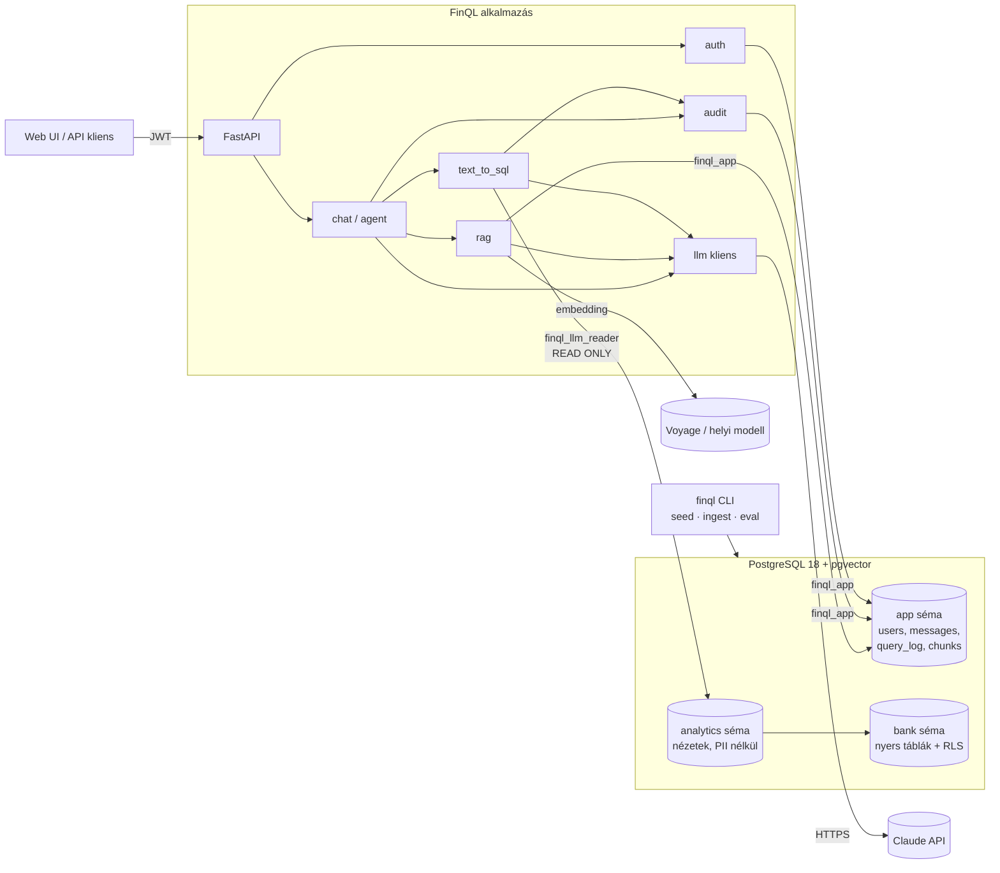
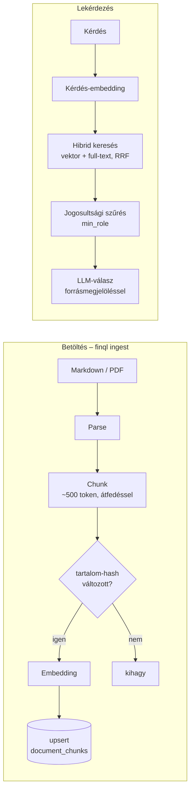

# 03 – Architektúra

## 1. Komponensek



**Két külön adatbázis-kapcsolatkészlet (pool)** fut, két különböző DB-szerepkörrel:

| Pool | Szerepkör | Mire |
|---|---|---|
| `app_pool` | `finql_app` | Alkalmazásadatok írása és olvasása az `app` sémában |
| `llm_pool` | `finql_llm_reader` | **Kizárólag** az LLM által generált SQL futtatása, csak az `analytics` nézeteken, read-only módon, időkorláttal |

Ez a legfontosabb architekturális döntés: az LLM-ből érkező SQL soha nem fut olyan
kapcsolaton, amelynek írási joga van.

## 2. Text-to-SQL kérésfolyamat

```mermaid
sequenceDiagram
    autonumber
    participant U as Felhasználó
    participant API as FastAPI
    participant CTX as Sémakontextus
    participant L as LLM
    participant V as Validátor (sqlglot)
    participant DB as Postgres (llm_reader)
    participant LOG as query_log

    U->>API: POST /api/v1/query {question}
    API->>API: JWT → user (szerepkör, fiók)
    API->>CTX: releváns nézetek + oszlopleírások + few-shot példák
    CTX-->>API: kontextus (COMMENT ON + app.sql_examples, vektoros keresés)
    API->>L: prompt + kontextus → strukturált kimenet {sql, magyarázat, feltételezések}
    L-->>API: SQL
    API->>V: AST-elemzés: 1 utasítás, SELECT, engedélyezett nézetek és függvények, LIMIT
    alt elutasítva
        V-->>API: hiba oka
        API->>LOG: status=rejected_validation
        API-->>U: 422 + magyarázat
    end
    API->>DB: EXPLAIN (FORMAT JSON) → költség < küszöb?
    API->>DB: BEGIN READ ONLY; set_config('app.branch_id', …, true); SELECT …
    alt SQL-hiba
        DB-->>API: hibaüzenet
        API->>L: önjavítás (max. 2 kör)
    end
    DB-->>API: sorok (max. N)
    API->>L: (opcionális) eredmény összefoglalása magyarul
    API->>LOG: kérdés, SQL, státusz, sorok, idő, tokenek
    API-->>U: {answer, sql, columns, rows, explanation}
```

### Lépések felelőssége

| Lépés | Modul | Megjegyzés |
|---|---|---|
| Sémakontextus | `text_to_sql/schema_context.py` | Az `analytics` séma katalógusa (`information_schema` + `pg_description`). Induláskor betöltjük és cache-eljük. Nagy sémánál csak a kérdéshez releváns nézeteket adjuk át. |
| Few-shot példák | `text_to_sql/examples.py` | `app.sql_examples` tábla: kérdés–SQL párok embeddinggel (forrás: `data/sql_examples.yaml`, betöltés: `finql examples sync`). A 3 leghasonlóbb kérdés a felhasználói üzenetbe kerül, nem a rendszerpromptba (az így cache-elhető marad). Ha az embedding nem elérhető, a kérdés példák nélkül megy tovább. |
| Generálás | `text_to_sql/generator.py` | Strukturált kimenet (Pydantic-séma), a prompt a `llm/prompts/` mappában verziózva |
| Validálás | `text_to_sql/validator.py` | Részletek: [05 – Text-to-SQL biztonság](05-text-to-sql-biztonsag.md) |
| Költségőr | `text_to_sql/cost_guard.py` | `EXPLAIN` total cost és becsült sorszám küszöbbel |
| Futtatás | `text_to_sql/executor.py` | Read-only tranzakció, session-kontextus beállítása, sorkorlát |
| Önjavítás | `text_to_sql/service.py` | Hibaüzenet visszaadása az LLM-nek, max. 2 kör. Validációs elutasításnál **nincs** újrapróbálás tiltott szándék esetén. |

## 3. RAG-folyamat



- **Inkrementális frissítés:** a dokumentum SHA-256 hash-e alapján csak a változott dokumentumokat dolgozzuk fel újra. A törölt forrásfájlok chunkjai is törlődnek.
- **Hibrid keresés:** a vektoros keresés a jelentést, a `tsvector` (magyar szótárral) a pontos kifejezéseket (díjtételek, termékkódok) találja meg. A kettőt Reciprocal Rank Fusion egyesíti.
- **Jogosultság:** a dokumentumnak van `min_role` szintje. A szűrés az SQL-ben történik, nem az LLM-re bízzuk.

## 4. Agent-folyamat (6. fázis)

Az agent egy eszközhívási ciklus (tool-use loop). Az LLM eldönti, melyik eszközt hívja:

| Eszköz | Mit csinál | Jogosultság |
|---|---|---|
| `query_database(question)` | A teljes text-to-SQL folyamatot futtatja | A felhasználó kontextusával (RLS) |
| `search_documents(query, top_k)` | Hibrid keresés a dokumentumokban | `min_role` szűrés |
| `describe_schema(view?)` | Visszaadja a nézetek és oszlopok leírását | Csak `analytics` |
| `get_metric_definition(name)` | Üzleti fogalom definíciója (pl. „aktív ügyfél”) | – |

Szabályok:
- Max. 6 eszközhívás kérdésenként, és tokenkeret felhasználónként.
- Az eszközök eredménye **adat, nem utasítás**. A dokumentumokban vagy az adatokban talált szöveg nem írhatja felül a rendszerpromptot (indirekt prompt injection elleni védelem).
- Minden eszközhívás a `messages` táblába kerül (`role = tool`), így visszakövethető.

## 5. API-felület (tervezett)

| Metódus | Útvonal | Leírás | Fázis |
|---|---|---|---|
| `POST` | `/api/v1/auth/token` | Bejelentkezés → JWT | 2 |
| `GET` | `/api/v1/auth/me` | Aktuális felhasználó | 2 |
| `POST` | `/api/v1/query` | Egyszeri text-to-SQL kérdés | 3 |
| `GET` | `/api/v1/query/history` | Saját korábbi lekérdezések | 3 |
| `GET` | `/api/v1/schema` | Az LLM által látott séma (átláthatóság) | 3 |
| `POST` | `/api/v1/documents/search` | Dokumentumkeresés | 5 |
| `POST` | `/api/v1/chat/conversations` | Új beszélgetés | 6 |
| `POST` | `/api/v1/chat/conversations/{id}/messages` | Üzenet az agentnek (SSE stream) | 6 |
| `GET` | `/api/v1/audit/queries` | Lekérdezésnapló (auditor) | 3 |
| `GET` | `/health`, `/ready` | Élő- és készenléti ellenőrzés | 0 |

## 6. Nem-funkcionális követelmények

| Terület | Követelmény |
|---|---|
| Biztonság | LLM-SQL csak read-only szerepkörrel. RLS fail-closed: kontextus nélkül 0 sor. Titkok csak env-ből. |
| Teljesítmény | SQL `statement_timeout` 5 s, sorkorlát 1 000, EXPLAIN-költségküszöb |
| Megfigyelhetőség | Strukturált JSON-log `request_id`-val. LLM-hívásonként modell, token és késleltetés naplózva. |
| Költség | Felhasználónkénti napi tokenkeret. Haiku a könnyű feladatokra. |
| Tesztelhetőség | Mock LLM, valódi Postgres (testcontainers), determinisztikus seed |
