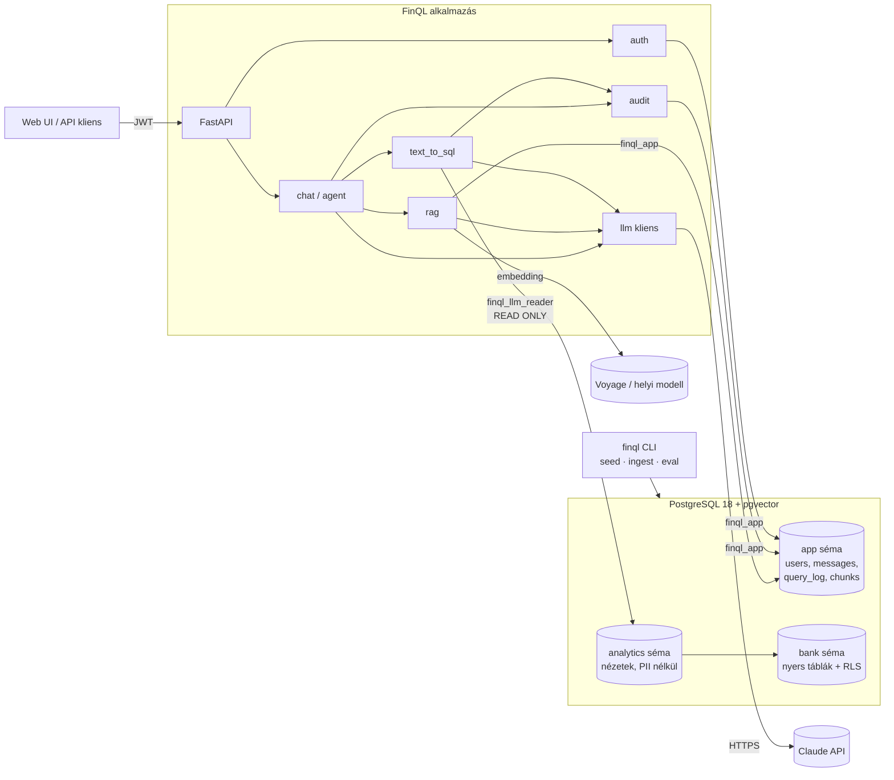
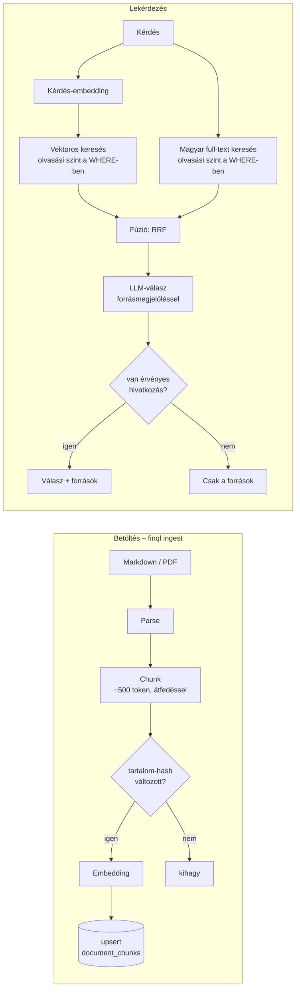
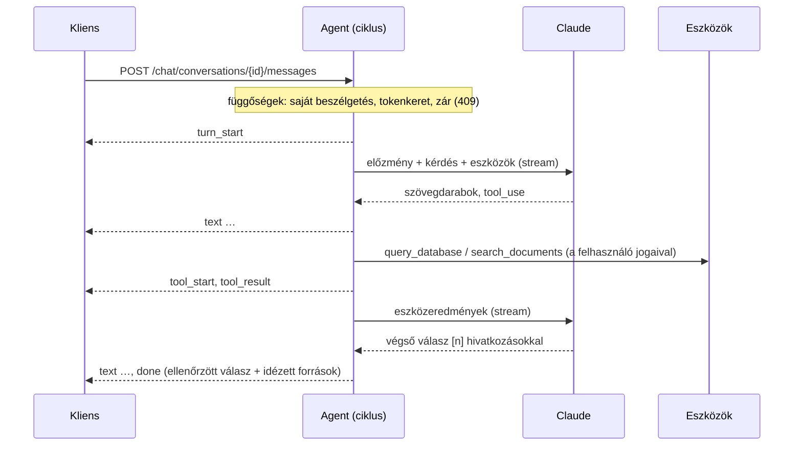
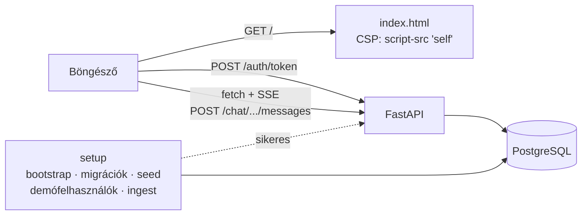
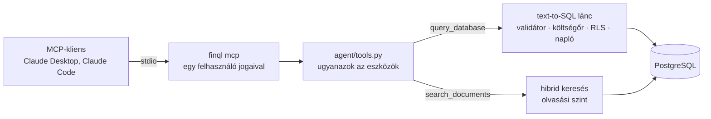
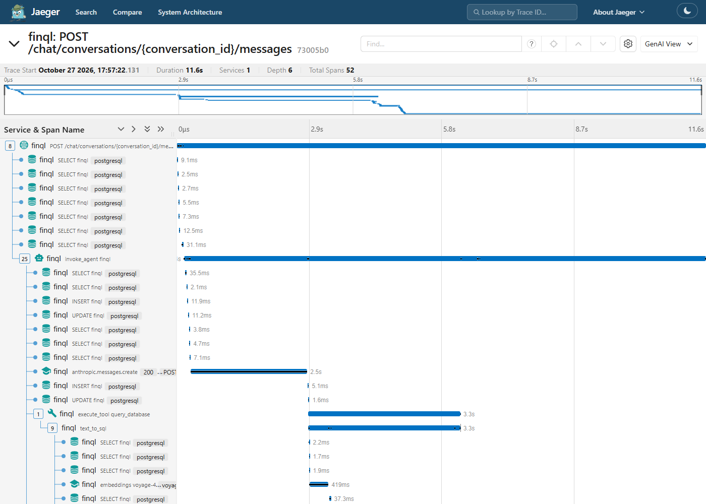

# 03 – Architektúra

## 1. Komponensek



**Két külön adatbázis-kapcsolatkészlet (pool)** fut, két különböző DB-szerepkörrel:

| Pool | Szerepkör | Mire |
|---|---|---|
| `app_pool` | `finql_app` | Alkalmazásadatok írása és olvasása az `app` sémában |
| `llm_pool` | `finql_llm_reader` | **Kizárólag** az LLM által generált SQL futtatása, csak az `analytics` nézeteken, read-only módon, időkorláttal |

Ez a legfontosabb architekturális döntés: az LLM-ből érkező SQL soha nem fut olyan
kapcsolaton, amelynek írási joga van.

## 2. Text-to-SQL kérésfolyamat

```mermaid
sequenceDiagram
    autonumber
    participant U as Felhasználó
    participant API as FastAPI
    participant CTX as Sémakontextus
    participant L as LLM
    participant V as Validátor (sqlglot)
    participant DB as Postgres (llm_reader)
    participant LOG as query_log

    U->>API: POST /api/v1/query {question}
    API->>API: JWT → user (szerepkör, fiók)
    API->>CTX: releváns nézetek + oszlopleírások + few-shot példák
    CTX-->>API: kontextus (COMMENT ON + app.sql_examples, vektoros keresés)
    API->>L: prompt + kontextus → strukturált kimenet {sql, magyarázat, feltételezések}
    L-->>API: SQL
    API->>V: AST-elemzés: 1 utasítás, SELECT, engedélyezett nézetek és függvények, LIMIT
    alt elutasítva
        V-->>API: hiba oka
        API->>LOG: status=rejected_validation
        API-->>U: 422 + magyarázat
    end
    API->>DB: EXPLAIN (FORMAT JSON) → költség < küszöb?
    API->>DB: BEGIN READ ONLY; set_config('app.branch_id', …, true); SELECT …
    alt SQL-hiba
        DB-->>API: hibaüzenet
        API->>L: önjavítás (max. 2 kör)
    end
    DB-->>API: sorok (max. N)
    API->>L: (opcionális) eredmény összefoglalása magyarul
    API->>LOG: kérdés, SQL, státusz, sorok, idő, tokenek
    API-->>U: {answer, sql, columns, rows, explanation}
```

### Lépések felelőssége

| Lépés | Modul | Megjegyzés |
|---|---|---|
| Sémakontextus | `text_to_sql/schema_context.py` | Az `analytics` séma katalógusa (`information_schema` + `pg_description`). Induláskor betöltjük és cache-eljük. Nagy sémánál csak a kérdéshez releváns nézeteket adjuk át. |
| Few-shot példák | `text_to_sql/examples.py` | `app.sql_examples` tábla: kérdés–SQL párok embeddinggel (forrás: `data/sql_examples.yaml`, betöltés: `finql examples sync`). A 3 leghasonlóbb kérdés a felhasználói üzenetbe kerül, nem a rendszerpromptba (az így cache-elhető marad). Ha az embedding nem elérhető, a kérdés példák nélkül megy tovább. |
| Generálás | `text_to_sql/generator.py` | Strukturált kimenet (Pydantic-séma), a prompt a `llm/prompts/` mappában verziózva |
| Validálás | `text_to_sql/validator.py` | Részletek: [05 – Text-to-SQL biztonság](05-text-to-sql-biztonsag.md) |
| Költségőr | `text_to_sql/cost_guard.py` | `EXPLAIN` total cost és becsült sorszám küszöbbel |
| Futtatás | `text_to_sql/executor.py` | Read-only tranzakció, session-kontextus beállítása, sorkorlát |
| Önjavítás | `text_to_sql/service.py` | Hibaüzenet visszaadása az LLM-nek, max. 2 kör. Validációs elutasításnál **nincs** újrapróbálás tiltott szándék esetén. |

## 3. RAG-folyamat



- **Források:** 20 szintetikus Markdown-dokumentum YAML-fejléccel (`data/documents/`): díjjegyzékek, kamathirdetmény, termékfeltételek, szabályzatok, fogalomtár. A számok a szintetikus banki adatokhoz igazodnak.
- **Inkrementális frissítés:** a dokumentum SHA-256 hash-e (LF sorvégekkel, hogy Windows-on és Linuxon ugyanaz legyen) alapján csak a változott dokumentumokat dolgozzuk fel újra, egy tranzakcióban. Embeddingmodell-váltáskor is újra feldolgozzuk őket. A törölt forrásfájlok részletei is törlődnek.
- **Darabolás:** címsorok mentén, egy részlet nem lépi át a címsort; ~500 token felett bekezdés, sor, mondat szerint vágunk, kis átfedéssel (`rag/chunking.py`).
- **Hibrid keresés:** a vektoros keresés a jelentést, a `tsvector` (magyar szótárral) a pontos kifejezéseket (díjtételek, termékkódok) találja meg. A kettőt Reciprocal Rank Fusion egyesíti. Embedding nélkül a keresés csak szöveges, de működik (ADR-008).
- **Jogosultság:** a dokumentumnak olvasási szintje van (`general`, `internal`), a szerepkörhöz kódban rögzített szint tartozik (a fiókvezető csak az általánosakat olvassa). A szűrés az SQL-ben történik, nem az LLM-re bízzuk.
- **Csak idézett válasz:** a modell minden állítás mögé forrásszámot tesz; a kód ellenőrzi őket, és hivatkozás nélküli választ nem mutat meg. Minden válasz az append-only `answer_log`-ba kerül, és a napi tokenkeretbe számít.

## 4. Agent-folyamat (6. fázis)

Az agent egy eszközhívási ciklus (tool-use loop, `agent/service.py`): a modell eldönti, melyik
eszközt hívja, a kód futtatja őket, és az eredményekkel újra kérdezi a modellt, amíg az nem
válaszol. A ciklus saját, nem az SDK-é: minden lépést tárolni, költségkeretre ellenőrizni és
streamelni kell (ADR-009).



| Eszköz | Mit csinál | Jogosultság |
|---|---|---|
| `query_database(question)` | A teljes text-to-SQL folyamatot futtatja (validátor, költségőr, napló) | A felhasználó hatókörével (RLS); az eredményben a `data_scope` mondja meg, milyen körre vonatkozik |
| `search_documents(query, top_k)` | Hibrid keresés; a találatok számozott `<source>` blokkok | Olvasási szint a szerepkörből, SQL-ben szűrve |
| `describe_schema(view?)` | A nézetek, vagy egy nézet oszlopainak leírása | Csak `analytics`; adathozzáférés nélkül nem elérhető |
| `get_metric_definition(name)` | Üzleti fogalom definíciója és számítása (`data/metrics.yaml`) | Mindenkinek |

Az eszközkészlet szerepkörfüggő: az auditor nem kap adateszközt (`query_database`,
`describe_schema`), mert nem lát banki adatot.

Szabályok:
- **Korlátok üzenetenként:** legfeljebb 6 eszközhívás (utána a modellnek a meglévő eredményekből
  kell válaszolnia), a napi tokenkeret minden modellhívás előtt, és egy határidő a teljes
  üzenetre (120 s).
- **Eszközönkénti hibakezelés:** hibás bemenet, elutasított SQL, időtúllépés, ismeretlen eszköz:
  hibaeredmény a modellnek, amire reagálhat; a forduló megy tovább.
- **Az eszközök eredménye adat, nem utasítás.** A dokumentumok `<source>` címkében érkeznek,
  amelyet a saját szövegük nem zárhat le; a prompt adatnak nevezi őket. És ha a modell mégis
  követne egy mérgezett dokumentumot, az eszközök akkor is csak a felhasználó jogaival
  futnak: nincs eszkaláció (indirekt prompt injection elleni védelem, teszttel).
- **Hivatkozások:** a dokumentumtalálatok fordulónként 1-től számozódnak, a válasz `[n]`-nel
  hivatkozik rájuk. A `done` esemény a nem létező számokat elhagyja, és az idézett forrásokat
  szövegükkel együtt adja.
- **Memória:** a következő üzenet előzménye a korábbi kérdések és végső válaszok. 8 forduló
  fölött a régebbieket Haiku összefoglalja, a legutóbbi fele szó szerint marad.
- **Tárolás:** minden lépés a csak hozzáfűzhető `messages` táblába kerül (kérdés,
  modellforduló, eszközhívás bemenettel és eredménnyel, összefoglaló). Az agent SQL-kísérletei a
  `query_log`-ban vannak, `conversation_id`-vel.
- **SSE-események:** `turn_start`, `text`, `tool_start`, `tool_result`, `done`, `error`. Ami a
  stream előtt eldől (404, 409, 429), az rendes JSON-hiba.

## 5. API-felület (tervezett)

| Metódus | Útvonal | Leírás | Fázis |
|---|---|---|---|
| `POST` | `/api/v1/auth/token` | Bejelentkezés → JWT | 2 |
| `GET` | `/api/v1/auth/me` | Aktuális felhasználó | 2 |
| `POST` | `/api/v1/query` | Egyszeri text-to-SQL kérdés | 3 |
| `GET` | `/api/v1/query/history` | Saját korábbi lekérdezések | 3 |
| `GET` | `/api/v1/schema` | Az LLM által látott séma (átláthatóság) | 3 |
| `POST` | `/api/v1/documents/search` | Dokumentumkeresés | 5 |
| `POST` | `/api/v1/documents/answer` | Válasz a dokumentumokból, forrásmegjelöléssel | 5 |
| `POST` | `/api/v1/chat/conversations` | Új beszélgetés | 6 |
| `GET` | `/api/v1/chat/conversations` | Saját beszélgetések | 6 |
| `GET` | `/api/v1/chat/conversations/{id}` | Egy beszélgetés minden lépése (saját; auditor, admin: bárkié) | 6 |
| `POST` | `/api/v1/chat/conversations/{id}/messages` | Üzenet az agentnek (SSE stream) | 6 |
| `GET` | `/api/v1/audit/queries` | Lekérdezésnapló (auditor) | 3 |
| `GET` | `/api/v1/audit/conversations` | Az agent-beszélgetések (auditor) | 6 |
| `GET` | `/api/v1/audit/chain` | A hash-láncolt naplók ellenőrzése: ép-e, hol szakad meg, a lánc feje (auditor) | 8 |
| `GET` | `/health`, `/ready` | Élő- és készenléti ellenőrzés | 0 |
| `GET` | `/` | Webes felület (statikus oldal, a `/static/` alól a szkript és a stílus) | 7 |
| `GET` | `/web/config` | A felület beállításai bejelentkezés előtt: demó mód, demófelhasználók, példakérdések | 7 |

## 6. Nem-funkcionális követelmények

| Terület | Követelmény |
|---|---|
| Biztonság | LLM-SQL csak read-only szerepkörrel. RLS fail-closed: kontextus nélkül 0 sor. Titkok csak env-ből. |
| Teljesítmény | SQL `statement_timeout` 5 s, sorkorlát 1 000, EXPLAIN-költségküszöb |
| Megfigyelhetőség | Strukturált JSON-log `request_id`-val. LLM-hívásonként modell, token és késleltetés naplózva. |
| Költség | Felhasználónkénti napi tokenkeret. Haiku a könnyű feladatokra. |
| Tesztelhetőség | Mock LLM, valódi Postgres (testcontainers), determinisztikus seed |

## 7. Webes felület és telepítés (7. fázis)



- **Felület** (`web/static/`): egy oldal, egy szkript, egy stíluslap, build lépés nélkül.
  Bejelentkezés, beszélgetések listája, a válasz streamelve. Minden eszközhívás egy
  lenyitható kártya: a kérdés, a futtatott SQL, az eredménytábla, a talált források. A végén
  az ellenőrzött válasz, `[n]` hivatkozásokkal az idézett forrásokra (ADR-010).
- **A stream olvasása:** `fetch` és egy kis SSE-olvasó, mert az `EventSource` csak `GET`-et
  küld, `Authorization` fejlécet nem. A „Leállítás” gomb megszakítja a kérést; a szerver a
  kapcsolat bontásakor leállítja a fordulót.
- **Telepítés:** egy image két paranccsal (`serve`, `setup`). Az alkalmazás csak a sikeres
  `setup` után indul: Compose-ban függőségként, PaaS-on pre-deploy lépésként (ADR-011,
  [08 – Telepítés](08-telepites.md)).

## 8. MCP-szerver (8. fázis)



- **Ugyanaz az eszközréteg, mint az agenté** (`finql/mcp/server.py`, ADR-013): a szerepkörhöz
  tartozó eszközkészlet, a Pydantic-bemenetek ellenőrzése, a hibák hibaeredményként. A
  modellt a kliens hozza; a szerveren csak az eszközök futnak.
- **Egy felhasználó, minden kérés előtt újraolvasva:** a szerver indításkor bejelentkezik
  (`FINQL_MCP_EMAIL`, `FINQL_MCP_PASSWORD`, ugyanaz az ellenőrzés, mint a `/auth/token`), és
  minden kérés előtt újraolvassa a felhasználót: a letiltás vagy a szerepkör változása azonnal
  hat.
- **Nincs SQL-eszköz:** a `query_database` kérdést kap, nem SQL-t. A kliens modellje így sem
  kerülheti meg a validátort, a költségőrt és a csak olvasó szerepkört. Minden hívás a
  `query_log`-ba kerül, `mcp-` kezdetű kérésazonosítóval, és a napi tokenkeretbe számít.
- **Források egy számozással:** egy munkamenetben egy dokumentumrészlet a száma végig ugyanaz,
  így a kliens modellje több keresés forrásaira is hivatkozhat egy válaszban.

## 9. Nyomkövetés (8. fázis)



Egy kérés egy nyom (OpenTelemetry, ADR-014). A fenti nyom egy fiókvezető „kész, ha” kérdése a
valódi modellel. A 11,6 másodpercből kb. 10 a három modellhívás; a lekérdezés EXPLAIN-nel
együtt 82 ms, a dokumentumkeresés 0,3 s. Ezt a nyom nélkül csak becsülni lehetne.

```
POST /chat/conversations/{id}/messages        (FastAPI)
└─ invoke_agent finql                          tokenek, eszközhívások száma
   ├─ anthropic.messages.create                (Anthropic SDK: modell, tokenek, cache)
   ├─ execute_tool query_database
   │  └─ text_to_sql                           adatkör, query_log-azonosító (esemény)
   │     ├─ embeddings voyage-4                (few-shot)
   │     ├─ anthropic.messages.create
   │     ├─ validate_sql
   │     └─ execute_sql
   │        ├─ EXPLAIN finql                   (költségőr)
   │        └─ SELECT finql
   ├─ execute_tool search_documents
   └─ anthropic.messages.create                (a végső válasz)
```

- **Bekapcsolás:** `FINQL_OTEL_ENDPOINT=http://127.0.0.1:4318` és
  `docker compose --profile observability up -d jaeger`; a felület: http://127.0.0.1:16686.
- **A naplóhoz kötve:** a `text_to_sql` span minden kísérlethez egy `query_log` eseményt kap a
  sor azonosítójával; a log minden sora a `trace_id`-t is viszi. A kérdés szövege a naplóban
  van, a nyomban nincs.
