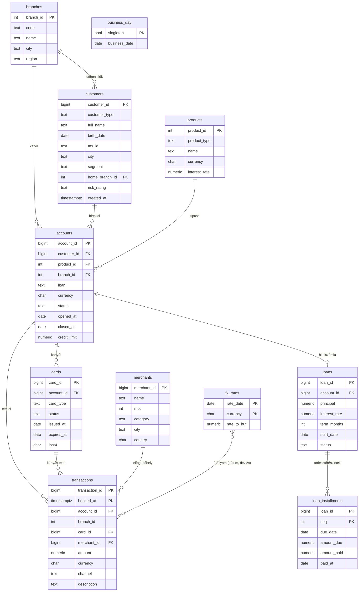

# 04 – Adatbázis

## 1. Sémák és tulajdonviszonyok

| Séma | Mi van benne | Megközelítés | Ki olvassa |
|---|---|---|---|
| `bank` | A banki domain nyers táblái (ügyfelek, számlák, tranzakciók…) | **DB-first** (`db/bank/*.sql`) | Csak a `finql_analytics` (nézettulajdonos) |
| `analytics` | Nézetek: az LLM számára kiajánlott **szemantikai réteg**, PII nélkül | **DB-first** (`db/analytics/*.sql`) | `finql_llm_reader` |
| `app` | Alkalmazásadatok: felhasználók, beszélgetések, napló, dokumentumok, embeddingek | **Code-first** (SQLAlchemy → Alembic) | `finql_app` |
| `app_ctx` | Segédfüggvények a session-kontextushoz (RLS) | DB-first (`db/security/*.sql`) | `finql_analytics`, `finql_llm_reader` (`EXECUTE`) |

## 2. Adatbázis-szerepkörök

```text
finql_owner          NOLOGIN   minden objektum tulajdonosa (a migrációk ezzel futnak)
 └─ finql_migrator   LOGIN     Alembic ezzel csatlakozik (tagja: finql_owner)
finql_app            LOGIN     az alkalmazás: RW az app sémán, a bank/analytics sémához nincs joga
finql_analytics      NOLOGIN   az analytics nézetek tulajdonosa, SELECT a bank táblákon, RLS vonatkozik rá
finql_llm_reader     LOGIN     LLM-SQL futtatása: csak SELECT az analytics nézeteken
```

### Hogyan jönnek létre?

A szerepkörök a **teljes klaszterre** szólnak, nem egy adatbázisra, ezért nem Alembic-migráció
hozza létre őket (egy `alembic downgrade` sem törölheti őket). Egy egyszeri, adminisztrátori
lépés teszi ezt meg, ahogy egy bankban is a DBA-k kezelik a szerepköröket:

```bash
uv run finql db bootstrap     # FINQL_ADMIN_DATABASE_URL-lel; idempotens
uv run alembic upgrade head   # FINQL_MIGRATION_DATABASE_URL-lel (finql_migrator)
```

| Lépés | Ki futtatja | Mit csinál |
|---|---|---|
| `db/roles/001_roles.sql` | admin (`finql db bootstrap`) | Létrehozza a szerepköröket, és minden futáskor újra rögzíti az attribútumaikat (`NOSUPERUSER … NOBYPASSRLS`). Beállítja a `finql_llm_reader` session-korlátait (read-only, `statement_timeout`, `search_path`, `jit = off`) és időzónáját (`Europe/Budapest`). A `finql_owner` `SET`-joggal (de `INHERIT` nélkül) tagja lesz a `finql_analytics`-nak, hogy átadhassa neki a nézeteket. Az adatbázis tulajdonosa a `finql_owner` lesz, `CONNECT` joga csak a mi szerepköreinknek van. |
| `db/extensions/001_pgvector.sql` | admin (`finql db bootstrap`) | A `vector` bővítmény egy saját `extensions` sémában (a pgvector nem „trusted”, csak superuser hozhatja létre). `USAGE` csak a `finql_owner`-nek és a `finql_app`-nak; az adatbázis `search_path`-ja a sémanév nélküli `vector` típus és `<=>` operátor miatt tartalmazza. |
| Jelszavak | admin (`finql db bootstrap`) | A jelszó a komponens saját kapcsolati URL-jéből jön (`FINQL_DATABASE_URL` → `finql_app` stb.). Minden jelszó egy helyen van megadva, a repóban sehol. |
| Migrációk | `finql_migrator` | Az `env.py` első lépése `SET ROLE finql_owner`, így minden objektum (az Alembic verziótáblája is) a `finql_owner`-é, bárki futtatja is. |

```sql
-- db/roles/001_roles.sql (részlet)
ALTER ROLE finql_llm_reader SET default_transaction_read_only = on;
ALTER ROLE finql_llm_reader SET statement_timeout = '5s';
ALTER ROLE finql_llm_reader SET idle_in_transaction_session_timeout = '10s';
ALTER ROLE finql_llm_reader SET search_path = analytics;
ALTER ROLE finql_llm_reader SET timezone = 'Europe/Budapest';

-- db/bank/090_grants.sql: táblánként, NEM „ON ALL TABLES IN SCHEMA bank”
GRANT USAGE ON SCHEMA bank TO finql_analytics;
GRANT SELECT ON bank.branches, bank.customers, bank.accounts, …, bank.transactions TO finql_analytics;
```

**Miért budapesti időzóna?** A bank naptára budapesti: a havi partíciók határa, a `booked_date`
és a havi összesítő is budapesti éjféltől számol. UTC-session esetén a generált SQL
`booked_at >= '2025-09-01'` feltétele két órával később kezdené a hónapot, így más eredményt adna,
mint a `booked_date`-re vagy az összesítőre írt változat, és a szomszédos partíciót is olvasná.
Ezt a 4. fázis evalja hozta elő; teszt őrzi (`test_executor.py`). A válaszban az időbélyegek
szintén budapesti időben jelennek meg (`executor._jsonable`).

**Miért táblánként?** Az `ON ALL TABLES IN SCHEMA` a havi partíciókra is jogot adna. Ha egy
partíciót közvetlenül kérdezünk le, a szülőtábla RLS-policyja nem érvényesül, csak a partícióé.
Így a `finql_analytics` csak a szülőtáblát olvashatja, a partíciókat nem (ezt teszt is ellenőrzi).

**Miért kell külön nézettulajdonos (`finql_analytics`)?** A nézet alapesetben a
tulajdonosa jogaival olvassa az alaptáblákat. Ha a tulajdonos maga a táblatulajdonos
(`finql_owner`) lenne, megkerülné az RLS-t. Egy külön, nem tulajdonos szerepkörre az RLS
érvényes, az `llm_reader` pedig csak a nézeteket látja, a nyers táblákat és a PII-t nem.

## 3. `bank` séma (DB-first)

### ER-diagram



### DDL-vázlat (a fontos részletekkel)

```sql
-- db/bank/001_types.sql
CREATE TYPE bank.customer_segment AS ENUM ('retail', 'premium', 'sme', 'corporate');
CREATE TYPE bank.tx_channel       AS ENUM ('card', 'transfer', 'atm', 'direct_debit', 'fee', 'interest');
CREATE TYPE bank.account_status   AS ENUM ('active', 'frozen', 'closed');

-- db/bank/010_transactions.sql: havi particionálás
CREATE TABLE bank.transactions (
    transaction_id  bigint GENERATED ALWAYS AS IDENTITY,
    booked_at       timestamptz     NOT NULL,
    account_id      bigint          NOT NULL REFERENCES bank.accounts,
    branch_id       int             NOT NULL,  -- szándékos denormalizálás: RLS + szűrés JOIN nélkül
    card_id         bigint          REFERENCES bank.cards,
    merchant_id     bigint          REFERENCES bank.merchants,
    amount          numeric(18, 2)  NOT NULL CHECK (amount <> 0),       -- előjeles: + jóváírás, − terhelés
    currency        char(3)         NOT NULL,
    channel         bank.tx_channel NOT NULL,
    description     text,
    PRIMARY KEY (transaction_id, booked_at),                            -- a partíciókulcsnak benne kell lennie
    -- az összetett FK garantálja, hogy a denormalizált branch_id egyezik a számla fiókjával
    FOREIGN KEY (account_id, branch_id) REFERENCES bank.accounts (account_id, branch_id)
) PARTITION BY RANGE (booked_at);

CREATE TABLE bank.transactions_default PARTITION OF bank.transactions DEFAULT;

-- havi partíciók budapesti éjfélhatárokkal (téli és nyári időszámításban is), idempotens:
SELECT bank.create_transaction_partitions('2024-10-01', '2026-09-30');
-- → transactions_2026_04: FROM ('2026-03-31 22:00+00') TO ('2026-04-30 22:00+00')

CREATE INDEX ON bank.transactions (account_id, booked_at);
CREATE INDEX ON bank.transactions (branch_id, booked_at);
CREATE INDEX ON bank.transactions (merchant_id) WHERE merchant_id IS NOT NULL;
```

> Megjegyzés: identity oszlop particionált táblán a PostgreSQL 17 óta támogatott.

További részletek a megvalósításban (`db/bank/`):

- **Enumok** minden zárt értékkészletre (szegmens, csatorna, státuszok, terméktípus): a hibás érték már beszúráskor elbukik, és az LLM-kontextusban pontosan felsorolhatók az értékek.
- **CHECK-ek az üzleti szabályokra:** magánszemélynek van születési dátuma, cégnek nincs; a szegmens illeszkedik az ügyféltípushoz; az adóazonosító formátuma típusfüggő; `closed` státuszhoz kötelező a `closed_at`; kártyás tétel csak `card` vagy `atm` csatornán lehet.
- **`bank.business_day`:** egysoros tábla az aktuális üzleti nappal. A késedelem és a „ma” ehhez mérődik, nem a `current_date`-hez, így a szintetikus adatállomány hónapok múlva is ugyanazt mutatja.
- **`bank.fx_rates`:** minden naptári napra van sor (hétvégén és ünnepnap az előző munkanapé), így a napi JOIN sosem marad üresen.
- **FK-indexek:** a PostgreSQL nem indexeli automatikusan az idegen kulcsokat, ezért a JOIN-okhoz szükségeseket a `020_indexes.sql` hozza létre.

### Szemantikai leírások (az LLM ebből tanulja meg a sémát)

```sql
-- db/analytics/090_comments.sql
COMMENT ON VIEW analytics.transactions IS
  'Könyvelt számlatranzakciók. Egy sor egy tétel. Az amount előjeles: negatív = terhelés (költés), pozitív = jóváírás.';
COMMENT ON COLUMN analytics.transactions.amount_huf IS
  'Az összeg forintban, a könyvelés napi MNB-árfolyamán. Devizák közötti összesítéshez ezt használd.';
COMMENT ON COLUMN analytics.customers.segment IS
  'Ügyfélszegmens: retail (lakossági), premium, sme (kisvállalkozás), corporate (nagyvállalat).';
```

## 4. `analytics` séma: nézetek az LLM számára

Elvek:
- **Csak a nézetek láthatók.** Ezek stabil, dokumentált, kérdezésre optimalizált felületet adnak.
- **Nincs PII:** név, adóazonosító, teljes IBAN, születési dátum, kártyaszám vége és tranzakciós közlemény nem szerepel. Helyettük korcsoport és maszkolt IBAN.
- **Előre számolt fogalmak:** `amount_huf`, `days_past_due`, `dpd_bucket`, `is_active`, hogy az LLM ne találgassa az üzleti logikát.
- **A „ma” az üzleti nap** (`analytics.business_day`), nem a `current_date`.
- **Minden nézetnek és oszlopnak van leírása** (`COMMENT ON`, `db/analytics/090_comments.sql`): jelentés, egység, lehetséges értékek, használati tipp. Ebből áll össze a 3. fázisban az LLM-kontextus. Teszt ellenőrzi, hogy egy sem hiányzik.

| Nézet | Tartalom | Fiókhoz kötött |
|---|---|---|
| `branches`, `products`, `merchants`, `fx_rates`, `business_day` | Törzsadatok | nem |
| `customers` | Ügyfél-ID, típus, szegmens, város, `age_band`, otthoni fiók, kockázati besorolás, `customer_since`, `is_active` | igen |
| `accounts` | Számla, termék és terméktípus, deviza, státusz, `is_active`, nyitás/zárás, hitelkeret, maszkolt IBAN, fiók | igen |
| `cards` | Kártya, típus, státusz, kibocsátás, lejárat | igen |
| `transactions` | Tételek + `amount_huf`, `booked_date` (budapesti idő), kereskedő neve és kategóriája, csatorna | igen |
| `loans` | Hitelek + `remaining_amount`, `overdue_amount`, `days_past_due`, `dpd_bucket` ('0', '1-30', '31-60', '61-90', '90+') | igen |
| `monthly_account_summary` | Számla × hónap: tételszám, be- és kifolyás, kártyás költés (materializált összesítőből) | igen |

```sql
-- db/analytics/030_transactions.sql (részlet)
CREATE VIEW analytics.transactions AS
SELECT t.transaction_id, t.account_id, t.branch_id, t.booked_at,
       (t.booked_at AT TIME ZONE 'Europe/Budapest')::date AS booked_date,
       t.amount, t.currency,
       -- hiányzó árfolyamnál NULL, nem csendben 1
       CASE WHEN t.currency = 'HUF' THEN t.amount ELSE round(t.amount * fx.rate_to_huf, 2) END AS amount_huf,
       t.channel, t.merchant_id, m.name AS merchant_name, m.category AS merchant_category
FROM bank.transactions t
LEFT JOIN bank.merchants m ON m.merchant_id = t.merchant_id
LEFT JOIN bank.fx_rates fx
       ON fx.currency = t.currency
      AND fx.rate_date = (t.booked_at AT TIME ZONE 'Europe/Budapest')::date;
```

A nézeteket a `finql_owner` hozza létre, a leírásokat is ő írja, és **utolsó lépésként** adja át
őket a `finql_analytics`-nak (`099_ownership_grants.sql`). A `finql_owner` csak `SET`-joggal tagja a
`finql_analytics`-nak, `INHERIT`-tel nem, így a tulajdonosváltás után már nem módosíthatja őket.

### A materializált összesítő és az RLS

A materializált nézet **pillanatfelvétel**: a lekérdezésekor az alaptáblák RLS-e nem érvényesül,
és materializált nézetre policy sem tehető. Ha az LLM közvetlenül olvashatná, egy fiókvezető minden
fiók havi adatát látná. Ezért:

- a nyers összesítő a `bank` sémában van (`bank.monthly_account_summary`, a táblatulajdonosé, a seed frissíti);
- az LLM csak az `analytics.monthly_account_summary` nézetet látja, amely a policy-kkel azonos fiókfeltétellel szűr (`security_barrier`, hogy a felhasználó szűrője ne futhasson előbb);
- a `finql_llm_reader` közvetlen hozzáférését teszt zárja ki.

### Teljesítmény: amit a mérés mutatott

A `small` skálán (2 millió tranzakció) a példakérdések először időtúllépéssel (5 s) álltak le.
Három javítás után mindegyik 200 ms alatt fut:

| Probléma | Ok | Javítás |
|---|---|---|
| `rows=1` becslés, ezért nested loop több százezer × több ezer sorra | A nézet `channel::text`-re castolta az enumot, így a `channel = 'card'` szűrőhöz nem volt statisztika (0,5% helyett valójában ~34%) | Az enum oszlopok castolás nélkül kerülnek a nézetbe |
| A szűrő nem jutott le a nézet alá | `security_barrier` minden nézeten; az enum `=` operátora nem `LEAKPROOF` | `security_barrier` csak ott, ahol a nézet maga szűr (havi összesítő). A többi nézetnél a szűrést az RLS végzi, amely amúgy is a felhasználó szűrői előtt fut. |
| ~200-szoros alulbecslés „minden fiók” módban | Az inline-olt `app_ctx` függvények kifejezésére a tervezőnek nincs statisztikája | A policy-k skalár részlekérdezést használnak: `(SELECT app_ctx.all_branches())`. Ez InitPlanként egyszer fut le (fiókszinten 218 → 81 ms), és a becslés ~2-szeres pontosságon belül marad. |
| 90 ms-os hitellekérdezésből 400 ms | JIT-fordítás (~300 ms) a magas becsült költség miatt | `ALTER ROLE finql_llm_reader SET jit = off`: az LLM rövid, interaktív lekérdezéseket futtat |

## 5. Row-Level Security (fiókszintű láthatóság)

A session-kontextust a futtató (executor) állítja be **tranzakción belül** (`is_local = true`),
paraméterezve. Az LLM által generált SQL nem hívhat `set_config`-ot, ezt a validátor
függvény-engedélylistája zárja ki.

```sql
-- db/security/001_app_ctx.sql
CREATE FUNCTION app_ctx.branch_id() RETURNS int
LANGUAGE sql STABLE PARALLEL SAFE AS $$
    SELECT nullif(current_setting('app.branch_id', true), '')::int
$$;

CREATE FUNCTION app_ctx.all_branches() RETURNS boolean
LANGUAGE sql STABLE PARALLEL SAFE AS $$
    SELECT coalesce(current_setting('app.scope', true), '') = 'all'
$$;

-- db/security/010_rls.sql
ALTER TABLE bank.transactions ENABLE ROW LEVEL SECURITY;
CREATE POLICY branch_scope ON bank.transactions
    FOR SELECT TO finql_analytics
    USING ((SELECT app_ctx.all_branches()) OR branch_id = (SELECT app_ctx.branch_id()));
-- ugyanígy: customers (home_branch_id), accounts; cards, loans, loan_installments a számlán keresztül (EXISTS)
```

- **Fail-closed:** kontextus nélkül `branch_id = NULL`, vagyis 0 sor. Egy elfelejtett beállítás így nem vezet adatszivárgáshoz. Érvénytelen érték (pl. `'7 OR true'`) esetén a cast hibát dob, a lekérdezés elbukik.
- **Kinek szól a policy?** Csak a `finql_analytics`-nak, mert a nézetek az ő nevében olvassák a táblákat. Más szerepkörre nincs policy, így bekapcsolt RLS mellett alapból semmit sem látnak. A táblatulajdonos (migráció, seed) nem érintett.
- **`EXECUTE` jog:** a policy-ben hívott függvények jogát a PostgreSQL a lekérdezést futtató szerepkörre ellenőrzi (nem a nézet tulajdonosára), ezért a `finql_llm_reader` is kap `EXECUTE`-ot az `app_ctx` függvényekre.
- **Ismert határ:** az adatbázis önmagában nem akadályozza meg, hogy az LLM-szerepkör egy `SET app.scope = 'all'` vagy egy `set_config(...)` hívással kitágítsa a saját kontextusát. Ezt a 2. réteg zárja ki (a validátor csak egyetlen `SELECT`-et enged, függvény-engedélylistával), lásd [05 – Text-to-SQL biztonság](05-text-to-sql-biztonsag.md). Az RLS a fiókvezető hibás vagy rosszindulatú *kérdése* ellen véd, a validátor a *generált SQL* ellen.

A futtatás menete az alkalmazásban:

```sql
BEGIN READ ONLY;
SELECT set_config('app.branch_id', $1, true),   -- a JWT-ből, nem az LLM-ből
       set_config('app.scope',     $2, true);   -- 'all' (analyst) vagy 'branch'
SET LOCAL statement_timeout = '5s';
<validált LLM-SQL, LIMIT-tel>;
COMMIT;
```

A biztonsági tulajdonságokat integrációs tesztek rögzítik (`tests/integration/test_security.py`):
kontextus nélkül 0 sor, fiókszinten pontosan a saját fiók sorai, `all` módban minden sor, a pécsi
fiókvezető nem látja a budaörsi ügyfeleket, nincs írás (read-write tranzakcióban sem), nincs PII
oszlop, maszkolt IBAN, a materializált összesítő közvetlenül nem olvasható, a nézettulajdonos nem
kerülheti meg az RLS-t, és az LLM-szerepkör csak az `analytics` és az `app_ctx` sémát látja.

## 6. `app` séma (code-first, SQLAlchemy)

A séma és a jogok SQL-ben vannak (`db/app/000_schema.sql`): a `finql_app` alapértelmezett jogot
(`ALTER DEFAULT PRIVILEGES`) kap minden új táblára. A táblákat a modellekből az Alembic
autogenerate hozza létre, review után. Egy teszt (`alembic check`) jelzi, ha egy modell
migráció nélkül változott.

**Hivatkozás a DB-first sémára:** az `app.users.branch_id` FK-val mutat a `bank.branches`-re.
A modellben a `bank.branches` csak egy egyoszlopos csonk (`core/base_model.py`), amelyet az
`env.py` `include_object` szűrője kihagy az autogenerate-ből. Emiatt a seed a fiókokat
nem `TRUNCATE`-tel, hanem upserttel tölti újra. A `TRUNCATE … CASCADE` ugyanis a
felhasználókat is törölné, és ha egy kisebb skála kihagyna egy fiókot, amelyre felhasználó
hivatkozik, a seed érthető hibával leáll.

| Tábla | Fő oszlopok | Megjegyzés |
|---|---|---|
| `users` | `id uuid PK`, `email UNIQUE`, `password_hash`, `full_name`, `role` (enum), `branch_id NULL`, `is_active`, `daily_token_budget`, `created_at` | `branch_id` csak `branch_manager` esetén kötelező (CHECK); FK a `bank.branches`-re (code-first → DB-first); az e-mail kisbetűsen tárolva (CHECK) |
| `conversations` | `id`, `user_id FK`, `title`, `created_at`, `updated_at` | |
| `messages` | `id`, `conversation_id FK`, `role` (user/assistant/tool), `content jsonb`, `model`, `input_tokens`, `output_tokens`, `latency_ms`, `created_at` | Az eszközhívások is itt vannak |
| `query_log` | `id bigint identity`, `user_id`, `scope`, `branch_id`, `question`, `attempt`, `status` (enum), `generated_sql`, `executed_sql`, `rejection_reason`, `explain_cost`, `row_count`, `duration_ms`, `model`, `prompt_version`, `example_ids int[]`, `input_tokens`, `output_tokens`, `llm_latency_ms`, `request_id`, `created_at` | **Append-only:** `finql_app` csak `INSERT` és `SELECT` joggal (`db/app/010_query_log.sql`). Kísérletenként egy sor; a `scope` és a `branch_id` a futáskori hatókör. A `message_id` a 6. fázisban jön a `messages` táblával. |
| `documents` | `id`, `title`, `source_path UNIQUE`, `doc_type`, `min_role`, `content_hash`, `version`, `ingested_at` | A hash alapján ismerjük fel a változást |
| `document_chunks` | `id`, `document_id FK ON DELETE CASCADE`, `chunk_index`, `content`, `token_count`, `embedding vector(1024)`, `embedding_model`, `tsv tsvector GENERATED`, `metadata jsonb` | HNSW- és GIN-index |
| `sql_examples` | `id`, `question UNIQUE`, `sql`, `tags text[]`, `embedding vector(1024)`, `embedding_model`, `is_active`, `created_at`, `updated_at` | Dinamikus few-shot példák (forrás: `data/sql_examples.yaml`). A kiválasztás csak az aktuális modell vektorait hasonlítja össze. A fájlból törölt példa `is_active = false` lesz, nem törlődik: a `query_log.example_ids` hivatkozhat rá. Vektorindex nincs: pár tucat sort a szekvenciális olvasás gyorsabban végignéz. |
| `eval_runs` | `id`, `started_at`, `finished_at`, `model`, `prompt_version`, `few_shot_k`, `embedding_model`, `git_commit`, `label`, `question_count`, `accuracy`, `valid_sql_rate`, `refusal_rate`, `latency_p50_ms`, `latency_p95_ms`, `avg_tokens`, `metrics jsonb` | Egy `finql eval run`: ami a számokat befolyásolhatja, és a fő metrikák. A trend egy lekérdezés. |
| `eval_results` | `id`, `run_id FK ON DELETE CASCADE`, `dataset`, `question_id`, `question`, `scope`, `branch_id`, `passed`, `status`, `reason`, `generated_sql`, `attempts`, `latency_ms`, `input_tokens`, `output_tokens`, `example_ids`; `UNIQUE (run_id, dataset, question_id)` | Kérdésenként egy sor: két futás összevetése (`finql eval compare`) ebből készül. |

A `query_log.example_ids` mondja meg, mely few-shot példák voltak a kísérlet promptjában. Idegen
kulcs nincs: a napló csak hozzáfűzhető, és nem akadályozhatja egy példa törlését.

`query_log.status` értékei: `ok`, `declined` (az LLM nem írt SQL-t, mert a kérdés nem
válaszolható meg, vagy biztonsági okból elutasította), `rejected_validation`, `rejected_cost`,
`rejected_budget` (elfogyott a napi tokenkeret), `sql_error`, `timeout`, `llm_error`.

A napi tokenkeretet (`users.daily_token_budget`) ugyanebből a táblából számoljuk: a felhasználó
aznapi (budapesti naptári nap) összes input- és outputtokenje. A naplóírás saját tranzakcióban
fut, mert az elutasított kérdés hibaválasza visszagörgeti a kérés tranzakcióját, a naplósornak
viszont pont akkor kell megmaradnia.

```python
# src/finql/rag/models.py (vázlat)
class DocumentChunk(Base):
    __tablename__ = "document_chunks"
    __table_args__ = (
        Index(
            "ix_chunks_embedding_hnsw",
            "embedding",
            postgresql_using="hnsw",
            postgresql_with={"m": 16, "ef_construction": 64},
            postgresql_ops={"embedding": "vector_cosine_ops"},
        ),
        Index("ix_chunks_tsv", "tsv", postgresql_using="gin"),
        {"schema": "app"},
    )
    id: Mapped[int] = mapped_column(BigInteger, Identity(), primary_key=True)
    document_id: Mapped[uuid.UUID] = mapped_column(
        ForeignKey("app.documents.id", ondelete="CASCADE")
    )
    chunk_index: Mapped[int]
    content: Mapped[str] = mapped_column(Text)
    embedding: Mapped[list[float]] = mapped_column(Vector(1024))
    embedding_model: Mapped[str]
    tsv: Mapped[str] = mapped_column(
        TSVECTOR, Computed("to_tsvector('hungarian', content)", persisted=True)
    )
```

### Hibrid keresés (RRF)

```sql
WITH vec AS (
    SELECT c.id, row_number() OVER (ORDER BY c.embedding <=> :qvec) AS rnk
    FROM app.document_chunks c
    JOIN app.documents d ON d.id = c.document_id
    WHERE d.min_role <= :user_role_level
    ORDER BY c.embedding <=> :qvec
    LIMIT 40
), fts AS (
    SELECT c.id, row_number() OVER (ORDER BY ts_rank_cd(c.tsv, q) DESC) AS rnk
    FROM app.document_chunks c
    JOIN app.documents d ON d.id = c.document_id,
         websearch_to_tsquery('hungarian', :qtext) q
    WHERE c.tsv @@ q AND d.min_role <= :user_role_level
    ORDER BY ts_rank_cd(c.tsv, q) DESC
    LIMIT 40
)
SELECT id, sum(1.0 / (60 + rnk)) AS score
FROM (SELECT * FROM vec UNION ALL SELECT * FROM fts) s
GROUP BY id
ORDER BY score DESC
LIMIT 8;
```

Szűrt HNSW-keresésnél a pgvector iteratív scanje (`SET LOCAL hnsw.iterative_scan = relaxed_order`)
gondoskodik róla, hogy a szűrés után is meglegyen a kért elemszám.

## 7. Szintetikus adatok (seed)

```bash
uv run finql seed --scale small            # --seed 42 az alapértelmezés; --reset újratölt
```

| Skála | Ügyfél | Számla | Tranzakció | Időtáv | Futásidő* | Cél |
|---|---|---|---|---|---|---|
| `tiny` | 200 | ~470 | ~30 000 | 15 hónap | ~1 s | Unit- és integrációs tesztek, CI (15 hónap: legyen „tavaly szeptember” és negyedéves összevetés) |
| `small` | 10 000 | ~24 000 | ~2 millió | 24 hónap | ~55 s | Fejlesztés, demó |
| `large` | 50 000 | ~120 000 | ~15 millió | 36 hónap | ~9 perc | Teljesítménytesztek, EXPLAIN-küszöbök hangolása |

\* Windows-laptop, Docker Desktop, a generálással, az indexépítéssel és a `VACUUM ANALYZE`-zal együtt.

- **Reprodukálható:** rögzített a `seed` és az időszak is. Az utolsó hónap 2026 szeptembere, az üzleti nap 2026-09-30, nem „a tegnapi nap”. Így az eval-kérdések elvárt válaszai nem avulnak el. Minden lustán generált adatfolyam (ügyfelek, kártyák, tranzakciók) saját, a seedből származtatott véletlengenerátort kap, így a kimenet nem függ attól, mit olvastunk ki előbb.
- **Magyar adatok:** Faker `hu_HU` nevek és cégnevek, valódi fiókvárosok és környékbeli települések, érvényes ellenőrzőszámú IBAN (a nem kiosztott `999` bankkóddal), adóazonosító jel és adószám.
- **Valószerű eloszlások:** szegmensenként eltérő költési szint és kategóriapreferencia, havi fizetés vagy nyugdíj, csoportos beszedések (a gáz télen drágább), hétvégi és decemberi csúcs, ünnepnapi visszaesés, Zipf-eloszlású kereskedőnépszerűség, a devizaszámlák kártyás költése külföldi kereskedőknél, annuitásos hiteltörlesztés, évi 4,5%-os árszintemelkedés.
- **Kalibráció:** a generátor előre kiszámolja a várható tételszámot, és úgy állítja be az aktivitási szintet, hogy a tranzakciók száma a skála céljának ±10%-án belül legyen.
- **Betöltés `COPY`-val** (psycopg 3), egy tranzakcióban. A `transactions` másodlagos indexeit és FK-it a betöltés előtt eldobja, utána a katalógusból kiolvasott definíciókkal újraépíti (`pg_get_indexdef`, `pg_get_constraintdef`), végül `VACUUM (ANALYZE)` fut. Ha egy sor a default partícióba kerülne, a betöltés hibával leáll. A végén frissíti a materializált havi összesítőt is.

### Beépített „történetek”

Ezek teszik ellenőrizhetővé az eval-kérdéseket, mert ismert a helyes válasz:

| # | Történet | Melyik kérdést szolgálja |
|---|---|---|
| 1 | A **Debreceni fiók** (`DEB01`) kártyás költése az utolsó negyedévben (2026 Q3) 40%-kal nő. A `small` skálán +58,5%, a második helyezett fióké +22%. | Melyik fiókban nőtt a legjobban a kártyás költés negyedéves összevetésben? |
| 2 | **2025. márciusi kampány:** az új számlanyitások száma megduplázódik (`small`: 658, a többi hónapban átlagosan ~340). | Havi bontásban hogyan alakult az új számlanyitások száma 2025-ben? |
| 3 | **Decemberi csúcs:** a kártyás költés ~30%-kal haladja meg a novemberit. A hét legerősebb napjai a péntek és a szombat. | Teljes kártyás forgalom egy adott hónapban, szezonalitás |
| 4 | **Késedelmes hitelek:** ~4,4% (személyi kölcsön ~7,6%, lakáshitel ~1,8%). Magas kockázati besorolásnál ~5-ször akkora az esély, mint alacsonynál. | A hitelek hány százaléka késik 30/60/90 napnál többet, termékenként? |
| 5 | **Prémium ügyfelek:** többet költenek, és az étterem, a hotel és az utazás felülreprezentált. | Melyik 10 kereskedőnél költöttek a legtöbbet a prémium ügyfelek? |
