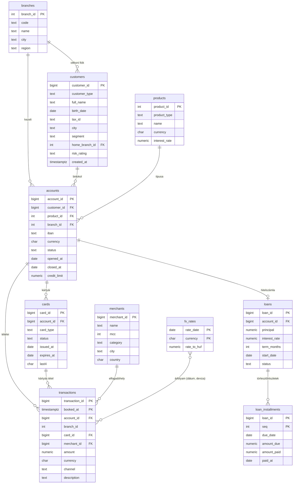

# 04 – Adatbázis

## 1. Sémák és tulajdonviszonyok

| Séma | Mi van benne | Megközelítés | Ki olvassa |
|---|---|---|---|
| `bank` | A banki domain nyers táblái (ügyfelek, számlák, tranzakciók…) | **DB-first** (`db/bank/*.sql`) | Csak a `finql_analytics` (nézettulajdonos) |
| `analytics` | Nézetek: az LLM számára kiajánlott **szemantikai réteg**, PII nélkül | **DB-first** (`db/analytics/*.sql`) | `finql_llm_reader` |
| `app` | Alkalmazásadatok: felhasználók, beszélgetések, napló, dokumentumok, embeddingek | **Code-first** (SQLAlchemy → Alembic) | `finql_app` |
| `app_ctx` | Segédfüggvények a session-kontextushoz (RLS) | DB-first | mindenki (`EXECUTE`) |

## 2. Adatbázis-szerepkörök

```text
finql_owner          NOLOGIN   minden objektum tulajdonosa (a migrációk ezzel futnak)
 └─ finql_migrator   LOGIN     Alembic ezzel csatlakozik (tagja: finql_owner)
finql_app            LOGIN     az alkalmazás: RW az app sémán, a bank/analytics sémához nincs joga
finql_analytics      NOLOGIN   az analytics nézetek tulajdonosa, SELECT a bank táblákon, RLS vonatkozik rá
finql_llm_reader     LOGIN     LLM-SQL futtatása: csak SELECT az analytics nézeteken
```

```sql
-- db/roles/001_roles.sql (vázlat; a jelszavak env-ből jönnek, nem a repóból)
CREATE ROLE finql_owner NOLOGIN;
CREATE ROLE finql_analytics NOLOGIN;            -- nem tulajdonos, nincs BYPASSRLS → az RLS érvényes rá
CREATE ROLE finql_app LOGIN;
CREATE ROLE finql_llm_reader LOGIN;

ALTER ROLE finql_llm_reader SET default_transaction_read_only = on;
ALTER ROLE finql_llm_reader SET statement_timeout = '5s';
ALTER ROLE finql_llm_reader SET idle_in_transaction_session_timeout = '10s';
ALTER ROLE finql_llm_reader SET search_path = analytics;

REVOKE ALL ON SCHEMA bank, app FROM PUBLIC;
GRANT USAGE ON SCHEMA bank TO finql_analytics;
GRANT SELECT ON ALL TABLES IN SCHEMA bank TO finql_analytics;
GRANT USAGE ON SCHEMA analytics TO finql_llm_reader;
GRANT SELECT ON ALL TABLES IN SCHEMA analytics TO finql_llm_reader;   -- nézetek
```

**Miért kell külön nézettulajdonos (`finql_analytics`)?** A nézet alapesetben a
tulajdonosa jogaival olvassa az alaptáblákat. Ha a tulajdonos maga a táblatulajdonos
(`finql_owner`) lenne, megkerülné az RLS-t. Egy külön, nem tulajdonos szerepkörre az RLS
érvényes, az `llm_reader` pedig csak a nézeteket látja, a nyers táblákat és a PII-t nem.

## 3. `bank` séma (DB-first)

### ER-diagram



### DDL-vázlat (a fontos részletekkel)

```sql
-- db/bank/001_types.sql
CREATE TYPE bank.customer_segment AS ENUM ('retail', 'premium', 'sme', 'corporate');
CREATE TYPE bank.tx_channel       AS ENUM ('card', 'transfer', 'atm', 'direct_debit', 'fee', 'interest');
CREATE TYPE bank.account_status   AS ENUM ('active', 'frozen', 'closed');

-- db/bank/010_transactions.sql: havi particionálás
CREATE TABLE bank.transactions (
    transaction_id  bigint GENERATED ALWAYS AS IDENTITY,
    booked_at       timestamptz     NOT NULL,
    account_id      bigint          NOT NULL REFERENCES bank.accounts,
    branch_id       int             NOT NULL REFERENCES bank.branches,  -- szándékos denormalizálás: RLS + szűrés JOIN nélkül
    card_id         bigint          REFERENCES bank.cards,
    merchant_id     bigint          REFERENCES bank.merchants,
    amount          numeric(18, 2)  NOT NULL CHECK (amount <> 0),       -- előjeles: + jóváírás, − terhelés
    currency        char(3)         NOT NULL,
    channel         bank.tx_channel NOT NULL,
    description     text,
    PRIMARY KEY (transaction_id, booked_at)                             -- a partíciókulcsnak benne kell lennie
) PARTITION BY RANGE (booked_at);

-- a partíciókat a seed / egy segédfüggvény hozza létre havonta, pl.:
CREATE TABLE bank.transactions_2026_01 PARTITION OF bank.transactions
    FOR VALUES FROM ('2026-01-01') TO ('2026-02-01');
CREATE TABLE bank.transactions_default PARTITION OF bank.transactions DEFAULT;

CREATE INDEX ON bank.transactions (account_id, booked_at);
CREATE INDEX ON bank.transactions (branch_id, booked_at);
CREATE INDEX ON bank.transactions (merchant_id) WHERE merchant_id IS NOT NULL;
```

> Megjegyzés: identity oszlop particionált táblán a PostgreSQL 17 óta támogatott.

### Szemantikai leírások (az LLM ebből tanulja meg a sémát)

```sql
-- db/analytics/090_comments.sql
COMMENT ON VIEW analytics.transactions IS
  'Könyvelt számlatranzakciók. Egy sor egy tétel. Az amount előjeles: negatív = terhelés (költés), pozitív = jóváírás.';
COMMENT ON COLUMN analytics.transactions.amount_huf IS
  'Az összeg forintban, a könyvelés napi MNB-árfolyamán. Devizák közötti összesítéshez ezt használd.';
COMMENT ON COLUMN analytics.customers.segment IS
  'Ügyfélszegmens: retail (lakossági), premium, sme (kisvállalkozás), corporate (nagyvállalat).';
```

## 4. `analytics` séma: nézetek az LLM számára

Elvek:
- **Csak a nézetek láthatók.** Ezek stabil, dokumentált, kérdezésre optimalizált felületet adnak.
- **Nincs PII:** név, adóazonosító, teljes IBAN és születési dátum nem szerepel. Helyettük korcsoport és maszkolt IBAN.
- **Előre számolt fogalmak:** `amount_huf`, `days_past_due`, `is_active`, hogy az LLM ne találgassa az üzleti logikát.
- **Lassú aggregátumok:** materializált nézetben, éjszakai frissítéssel.

| Nézet | Tartalom |
|---|---|
| `analytics.branches` | Fiókok (kód, név, város, régió) |
| `analytics.customers` | Ügyfél-ID, típus, szegmens, város, `age_band`, otthoni fiók, kockázati besorolás, `is_active` |
| `analytics.accounts` | Számla, terméktípus, deviza, státusz, nyitás/zárás, maszkolt IBAN, fiók |
| `analytics.transactions` | Tételek + `amount_huf`, `booked_date` (budapesti idő), kereskedő neve és kategóriája, csatorna |
| `analytics.loans` | Hitelek + `days_past_due`, `dpd_bucket` ('0', '1-30', '31-60', '61-90', '90+'), fennálló tőke |
| `analytics.monthly_account_summary` | *Materializált:* számla × hónap: be- és kifolyás, tételszám |

```sql
-- db/analytics/020_transactions.sql
CREATE VIEW analytics.transactions WITH (security_barrier = true) AS
SELECT t.transaction_id,
       t.account_id,
       t.branch_id,
       t.booked_at,
       (t.booked_at AT TIME ZONE 'Europe/Budapest')::date AS booked_date,
       t.amount,
       t.currency,
       round(t.amount * coalesce(fx.rate_to_huf, 1), 2) AS amount_huf,
       t.channel,
       m.name     AS merchant_name,
       m.category AS merchant_category
FROM bank.transactions t
LEFT JOIN bank.merchants m ON m.merchant_id = t.merchant_id
LEFT JOIN bank.fx_rates fx
       ON fx.currency = t.currency
      AND fx.rate_date = (t.booked_at AT TIME ZONE 'Europe/Budapest')::date;

ALTER VIEW analytics.transactions OWNER TO finql_analytics;
```

## 5. Row-Level Security (fiókszintű láthatóság)

A session-kontextust a futtató (executor) állítja be **tranzakción belül** (`is_local = true`),
paraméterezve. Az LLM által generált SQL nem hívhat `set_config`-ot, ezt a validátor
függvény-engedélylistája zárja ki.

```sql
-- db/security/001_app_ctx.sql
CREATE SCHEMA app_ctx;

CREATE FUNCTION app_ctx.branch_id() RETURNS int
LANGUAGE sql STABLE AS $$
    SELECT nullif(current_setting('app.branch_id', true), '')::int
$$;

CREATE FUNCTION app_ctx.all_branches() RETURNS boolean
LANGUAGE sql STABLE AS $$
    SELECT coalesce(current_setting('app.scope', true), '') = 'all'
$$;

-- db/security/010_rls.sql
ALTER TABLE bank.transactions ENABLE ROW LEVEL SECURITY;
CREATE POLICY branch_scope ON bank.transactions
    FOR SELECT TO finql_analytics
    USING (app_ctx.all_branches() OR branch_id = app_ctx.branch_id());
-- ugyanígy: customers (home_branch_id), accounts, cards, loans …
```

**Fail-closed:** kontextus nélkül `branch_id = NULL`, vagyis 0 sor. Egy elfelejtett beállítás
így nem vezet adatszivárgáshoz.

A futtatás menete az alkalmazásban:

```sql
BEGIN READ ONLY;
SELECT set_config('app.branch_id', $1, true),   -- a JWT-ből, nem az LLM-ből
       set_config('app.scope',     $2, true);   -- 'all' (analyst) vagy 'branch'
SET LOCAL statement_timeout = '5s';
<validált LLM-SQL, LIMIT-tel>;
COMMIT;
```

## 6. `app` séma (code-first, SQLAlchemy)

| Tábla | Fő oszlopok | Megjegyzés |
|---|---|---|
| `users` | `id uuid PK`, `email UNIQUE`, `password_hash`, `full_name`, `role` (enum), `branch_id NULL`, `is_active`, `daily_token_budget`, `created_at` | `branch_id` csak `branch_manager` esetén kötelező (CHECK) |
| `conversations` | `id`, `user_id FK`, `title`, `created_at`, `updated_at` | |
| `messages` | `id`, `conversation_id FK`, `role` (user/assistant/tool), `content jsonb`, `model`, `input_tokens`, `output_tokens`, `latency_ms`, `created_at` | Az eszközhívások is itt vannak |
| `query_log` | `id bigint identity`, `user_id`, `message_id NULL`, `question`, `generated_sql`, `executed_sql`, `status` (enum), `rejection_reason`, `explain_cost`, `row_count`, `duration_ms`, `model`, `input_tokens`, `output_tokens`, `attempt`, `created_at` | **Append-only:** `finql_app` csak `INSERT` és `SELECT` joggal |
| `documents` | `id`, `title`, `source_path UNIQUE`, `doc_type`, `min_role`, `content_hash`, `version`, `ingested_at` | A hash alapján ismerjük fel a változást |
| `document_chunks` | `id`, `document_id FK ON DELETE CASCADE`, `chunk_index`, `content`, `token_count`, `embedding vector(1024)`, `embedding_model`, `tsv tsvector GENERATED`, `metadata jsonb` | HNSW- és GIN-index |
| `sql_examples` | `id`, `question`, `sql`, `tags text[]`, `embedding vector(1024)`, `is_active` | Dinamikus few-shot példák |
| `eval_runs` / `eval_results` | futás: modell, promptverzió, pontosság; eredmény: kérdés-ID, helyes-e, SQL, hiba | Az eval-trendek az adatbázisban követhetők |

`query_log.status` értékei: `ok`, `rejected_validation`, `rejected_cost`, `sql_error`,
`timeout`, `llm_error`.

```python
# src/finql/rag/models.py (vázlat)
class DocumentChunk(Base):
    __tablename__ = "document_chunks"
    __table_args__ = (
        Index("ix_chunks_embedding_hnsw", "embedding",
              postgresql_using="hnsw",
              postgresql_with={"m": 16, "ef_construction": 64},
              postgresql_ops={"embedding": "vector_cosine_ops"}),
        Index("ix_chunks_tsv", "tsv", postgresql_using="gin"),
        {"schema": "app"},
    )
    id: Mapped[int] = mapped_column(BigInteger, Identity(), primary_key=True)
    document_id: Mapped[uuid.UUID] = mapped_column(ForeignKey("app.documents.id", ondelete="CASCADE"))
    chunk_index: Mapped[int]
    content: Mapped[str] = mapped_column(Text)
    embedding: Mapped[list[float]] = mapped_column(Vector(1024))
    embedding_model: Mapped[str]
    tsv: Mapped[str] = mapped_column(
        TSVECTOR, Computed("to_tsvector('hungarian', content)", persisted=True))
```

### Hibrid keresés (RRF)

```sql
WITH vec AS (
    SELECT c.id, row_number() OVER (ORDER BY c.embedding <=> :qvec) AS rnk
    FROM app.document_chunks c
    JOIN app.documents d ON d.id = c.document_id
    WHERE d.min_role <= :user_role_level
    ORDER BY c.embedding <=> :qvec
    LIMIT 40
), fts AS (
    SELECT c.id, row_number() OVER (ORDER BY ts_rank_cd(c.tsv, q) DESC) AS rnk
    FROM app.document_chunks c
    JOIN app.documents d ON d.id = c.document_id,
         websearch_to_tsquery('hungarian', :qtext) q
    WHERE c.tsv @@ q AND d.min_role <= :user_role_level
    ORDER BY ts_rank_cd(c.tsv, q) DESC
    LIMIT 40
)
SELECT id, sum(1.0 / (60 + rnk)) AS score
FROM (SELECT * FROM vec UNION ALL SELECT * FROM fts) s
GROUP BY id
ORDER BY score DESC
LIMIT 8;
```

Szűrt HNSW-keresésnél a pgvector iteratív scanje (`SET LOCAL hnsw.iterative_scan = relaxed_order`)
gondoskodik róla, hogy a szűrés után is meglegyen a kért elemszám.

## 7. Szintetikus adatok (seed)

| Skála | Ügyfél | Számla | Tranzakció | Időtáv | Cél |
|---|---|---|---|---|---|
| `tiny` | 200 | 500 | 20 000 | 3 hónap | Unit- és integrációs tesztek, CI |
| `small` | 10 000 | 25 000 | ~2 millió | 24 hónap | Fejlesztés, demó |
| `large` | 50 000 | 120 000 | ~15 millió | 36 hónap | Teljesítménytesztek, EXPLAIN-küszöbök hangolása |

- Faker `hu_HU`: magyar nevek, városok, IBAN-formátum. Rögzített `seed` a reprodukálhatóságért.
- Valószerű eloszlások: szegmensenkénti költési szint, hétvégi és ünnepi csúcsok, havi fizetés-jóváírás, ~4% késedelmes hitel.
- Betöltés `COPY`-val (psycopg 3 `copy()`), nem soronkénti INSERT-tel. A nagy táblák indexei és FK-i a betöltés után készülnek.
- A szándékosan beépített „történetek” (pl. egy fiók költése Q3-ban 30%-kal nő) ellenőrizhetővé teszik az eval-kérdéseket.
